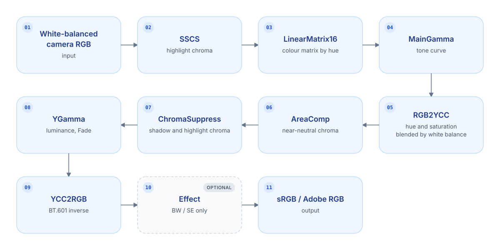
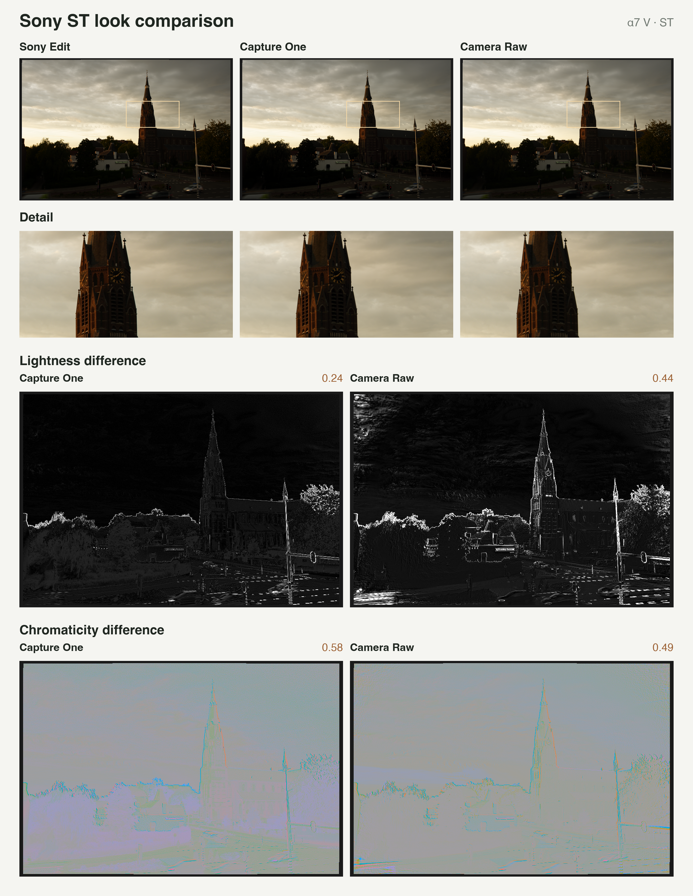

# Sony Look Bridge

[中文](README.zh-CN.md) | English

## Overview

This repository uses Python to reproduce the photo development and Creative Look implementation in Sony Imaging Edge Edit, and converts the reproduced colour mapping into profiles and LUTs for post-processing software.

The current version covers all 12 α7 V Creative Looks and provides three photo-profile formats for 17 Sony cameras. The α7 V also has video LUTs: 12 looks × 2 input gamuts × 3 white-balance variants.

| Output file | Use |
| --- | --- |
| Capture One ICC | Photo look profile |
| Camera Raw / Lightroom DCP + XMP | Photo profile and RGBTable, including white-balance-adaptive Auto profiles |
| DxO PhotoLab `.cube` | Photo LUT Grading |
| S-Log3 `.cube` | Creative Look LUTs for DaVinci Resolve and other post-processing software |

Related presentations: [Bilibili](https://www.bilibili.com/video/BV1VUH56pECK/) · [YouTube (English)](https://youtu.be/LeK9HhhYosQ)

## Edit colour pipeline



The complete stage order and parameters are documented in the [pipeline notes](docs/pipeline.md).

The figure below shows how neutral development, ST and FL2 affect the colour distribution:

<picture>
  <source media="(prefers-color-scheme: dark)" srcset="images/color_cube_en_dark.png">
  
</picture>

See [photo looks and host profiles](docs/photo.md) for the colour diagram and derivation. The [video LUT notes](docs/video.md) describe the measured bridge from S-Log3 to the photo look.

### ARW decoding

`sonylook/sony_decode.py` extends the per-pixel look chain with RawNR, ITP, DRO, lens geometry correction, Sharpness / Spica, Marble, ToneCurve and ShadeCorrection. The decoder uses the development settings stored in the ARW to produce a complete image:

```text
RAW → [RawNR] → ITP → [DRO] → [GeoCorr] → SSCS → LinearMatrix16 → MainGamma
    → RGB2YCC → AreaComp → ChromaSuppress → Sharpness → YGamma → [HueSaturation]
    → Spica → YCC2RGB → [Marble] → [Effect] → [ToneCurve] → [ShadeCorrection]
```

Stages in brackets run when the settings enable them. The output is the decoder rectangle (7008×4672 on the α7 V) in sRGB or Adobe RGB, written as TIFF, JPEG or PNG. See [pipeline notes](docs/pipeline.md) for every stage and parameter.

This repository contains only the Python implementation. A standalone complete decoder with Rust and Metal acceleration is maintained in the separate [sony-arw-decoder](https://github.com/751K/sony-arw-decoder) repository.

## Validation results



## Compatibility

Each camera pack contains profiles for Capture One, Camera Raw / Lightroom and DxO PhotoLab. Select a model name to download the corresponding file; see the [release page][release] for all 17 packs.

| Series | Available cameras |
| --- | --- |
| α1 / α9 | [α1][sony-a1] · [α1 II][sony-a1-ii] · [α9 III][sony-a9-iii] |
| α7 | [α7 IV][sony-a7-iv] · [α7 V][sony-a7-v] · [α7S III][sony-a7s-iii] |
| α7R / α7C | [α7R V][sony-a7r-v] · [α7R VI][sony-a7r-vi] · [α7C II][sony-a7c-ii] · [α7CR][sony-a7cr] |
| α6000 | [α6700][sony-a6700] |
| Cinema Line | [FX2][sony-fx2] · [FX3][sony-fx3] · [FX30][sony-fx30] |
| RX / ZV | [RX1R III][sony-rx1r-iii] · [ZV-E1][sony-zv-e1] · [ZV-E10 II][sony-zv-e10-ii] |

The α7 V, α7R VI, FX2 and RX1R III packs have 12 native looks; the others have 10 native looks plus FL2 / FL3 ported from α7 V. New packs use the α7 V input calibration; ST and FL2 were tested in ACR on α7C II. Each ZIP includes installation notes for its camera.

[sony-a1]: https://github.com/751K/sony-look-bridge/releases/download/v3.1.0/Sony-A1-Creative-Looks.zip

[sony-a1-ii]: https://github.com/751K/sony-look-bridge/releases/download/v3.1.0/Sony-A1-II-Creative-Looks.zip

[sony-a9-iii]: https://github.com/751K/sony-look-bridge/releases/download/v3.1.0/Sony-A9-III-Creative-Looks.zip

[sony-a7-iv]: https://github.com/751K/sony-look-bridge/releases/download/v3.1.0/Sony-A7-IV-Creative-Looks.zip

[sony-a7-v]: https://github.com/751K/sony-look-bridge/releases/download/v3.1.0/Sony-A7-V-Creative-Looks.zip

[sony-a7r-v]: https://github.com/751K/sony-look-bridge/releases/download/v3.1.0/Sony-A7R-V-Creative-Looks.zip

[sony-a7r-vi]: https://github.com/751K/sony-look-bridge/releases/download/v3.1.0/Sony-A7R-VI-Creative-Looks.zip

[sony-a7s-iii]: https://github.com/751K/sony-look-bridge/releases/download/v3.1.0/Sony-A7S-III-Creative-Looks.zip

[sony-a7c-ii]: https://github.com/751K/sony-look-bridge/releases/download/v3.1.0/Sony-A7C-II-Creative-Looks.zip

[sony-a7cr]: https://github.com/751K/sony-look-bridge/releases/download/v3.1.0/Sony-A7CR-Creative-Looks.zip

[sony-a6700]: https://github.com/751K/sony-look-bridge/releases/download/v3.1.0/Sony-A6700-Creative-Looks.zip

[sony-fx2]: https://github.com/751K/sony-look-bridge/releases/download/v3.1.0/Sony-FX2-Creative-Looks.zip

[sony-fx3]: https://github.com/751K/sony-look-bridge/releases/download/v3.1.0/Sony-FX3-Creative-Looks.zip

[sony-fx30]: https://github.com/751K/sony-look-bridge/releases/download/v3.1.0/Sony-FX30-Creative-Looks.zip

[sony-rx1r-iii]: https://github.com/751K/sony-look-bridge/releases/download/v3.1.0/Sony-RX1R-III-Creative-Looks.zip

[sony-zv-e1]: https://github.com/751K/sony-look-bridge/releases/download/v3.1.0/Sony-ZV-E1-Creative-Looks.zip

[sony-zv-e10-ii]: https://github.com/751K/sony-look-bridge/releases/download/v3.1.0/Sony-ZV-E10-II-Creative-Looks.zip

[release]: https://github.com/751K/sony-look-bridge/releases/tag/v3.1.0

[checksums]: https://github.com/751K/sony-look-bridge/releases/download/v3.1.0/SHA256SUMS.txt

## Usage

Install the photo profiles as described below; the video LUTs are described in [Video LUTs](#video-luts). The steps use the α7 V filenames. Each camera ZIP includes its own installation instructions.

### Look variants and white balance

The camera moves each look between two sets of colour parameters as the as-shot white balance changes: the warm-light set below about 3700K and the daylight set above about 5400K, blended in between (α7 V; the range differs slightly between cameras). Each colour look is therefore provided in the following variants:

| Variant | Name | Behaviour | Hosts |
| --- | --- | --- | --- |
| Daylight | `Look XX` | Daylight colour parameters | Capture One, Camera Raw / Lightroom, DxO PhotoLab |
| Warm | `Look XX Warm` | Warm-light colour parameters | Capture One, Camera Raw / Lightroom, DxO PhotoLab |
| Auto | `Look XX Auto` | Follows the white balance: matches Warm at about 3200K and below and Daylight at about 5500K and above, blends smoothly in between | Camera Raw / Lightroom only |

In Camera Raw and Lightroom, Auto is recommended: the look does not need to be switched when the colour temperature is changed. In Capture One and DxO PhotoLab, use Warm for low colour-temperature shots (below about 3700K) and Daylight otherwise. BW renders the same at every white balance and has only one version. See [Photo pipeline §4.3](docs/pipeline.md) for the camera behaviour and [Photo looks and host profiles](docs/photo.md) for how the Auto profiles work.

### Capture One

1. Copy `profiles/capture_one/SonyA7M5-Look-*.icc` to `~/Library/ColorSync/Profiles/`.
2. **Restart** Capture One, which caches profiles it has already loaded.
3. In *Base Characteristics*, set *ICC Profile* to `SonyA7M5 Look XX` and **Curve to Linear Response**.

### Camera Raw / Lightroom

1. Copy `profiles/camera_raw/SonyA7M5 Linear Base.dcp` and `profiles/camera_raw/SonyA7M5 Auto Base *.dcp` to `~/Library/Application Support/Adobe/CameraRaw/CameraProfiles/`.
2. Copy `profiles/camera_raw/SonyA7M5 Look *.xmp` to `~/Library/Application Support/Adobe/CameraRaw/Settings/`.
3. Restart Photoshop / Lightroom and select a look from the **Sony A7M5** group in the profile browser. The `Auto Base` DCPs are used by the Auto looks and do not need to be selected.

⚠️ Compatibility note: some Photoshop / Lightroom versions may not load these profiles correctly (for example, missing profiles or incorrect rendering). Lightroom Classic 15.4.1, for example, lists the looks but renders all of them like the Linear Base; Lightroom Classic 15.6 and Camera Raw 18.7 apply them correctly. If this occurs, update to a newer version.

### DxO PhotoLab

1. Copy `profiles/dxo/SonyA7M5 Linear Base v2.dcp` and `profiles/dxo/SonyA7M5 Look *.cube` to the folder specified above.
2. Start from the **6 – No correction** preset, or ensure that Smart Lighting, ClearView and Contrast are disabled. Lens corrections (distortion, chromatic aberration and lens sharpness) may be re-enabled; they do not change the look's colour.
3. *Color/B&W Rendering*: Type **DCP Profile** → *Import DCP Profile…* → `SonyA7M5 Linear Base v2.dcp`. Set **DCP Curve to Adobe**, Intensity 100, and **Protect Saturated Colors to 0** (switch off its automatic mode).
4. *DxO PL Elite – LUT Grading*: LUT file → *Import (.cube)…* → `SonyA7M5 Look XX.cube`; **LUT Color Space ProPhoto RGB**, Intensity 100.
5. The settings may optionally be saved as a preset; change looks by selecting another `.cube`.

### Video LUTs

**[Download Sony-A7-V-SLog3-Video-LUTs.zip](https://github.com/751K/sony-look-bridge/releases/download/v3.1.0/Sony-A7-V-SLog3-Video-LUTs.zip)** ([v3.1.0 release](https://github.com/751K/sony-look-bridge/releases/tag/v3.1.0)).

For video content, the project provides LUTs produced for the A7M5, with separate versions for S-Gamut3 and S-Gamut3.Cine. Each look comes in daylight, 4200K and warm variants for the white balance of the footage. The video LUTs output Rec.709 / Gamma 2.4.

See [usage](profiles/video/README.md) and [calibration and generation](docs/video.md).

## Repository layout

| Folder | Contents |
| --- | --- |
| `profiles/` | Generated photo profiles and video LUT generation records |
| `chart/` | Synthetic chart: `SonyChart.ARW` (opens in Capture One and Camera Raw), patch definitions `SonyChart.json`, preview image |
| `sonylook/` | Python port of Sony's look chain and front end, ARW and Edit readers. Also ports of RawNR, DRO, sharpening / Spica, Marble, lens geometry correction (none used by the profiles) and the BW/SE Effect stage (used), plus the end-to-end decoder `sony_decode.py` |
| `capture_one/` | Capture One profile generation, synthetic chart, measurement and comparison |
| `camera_raw/` | Camera Raw table format, DCP read/write, profile generation, measurement and comparison |
| `dxo/` | DxO PhotoLab model of the LUT input (`dxo_model.py`), probe and base-DCP generation, LUT generation |
| `camera_packs/` | Per-camera pack generator, camera metadata and the shared installation-note template used in each ZIP |
| `video/` | S-Log3 input transforms, sensor-matrix calibration, video LUT generation and tests |
| `docs/` | [Documentation index](docs/README.md): photo profiles, pipeline and video LUTs |

## Notes

- This project is not affiliated with Sony, Capture One, Adobe or DxO. All names and trademarks belong to their owners.
- The ColorMatrix values in the Camera Raw profiles come from Adobe Standard's A7M5 profile, so that Camera Raw's white balance behaves unchanged. The DxO base DCP uses Adobe Standard's ColorMatrix and D65 ForwardMatrix for the same reason.
- `dxo/dxo_model.py` re-implements PhotoLab's highlight recovery from its observed behaviour and contains a few values measured from PhotoLab while it runs (the DxO Wide Gamut matrices, the highlight white level); it contains no DxO code or files.

## License

- The code, documentation and the work of generating the profiles are released under the [MIT License](LICENSE).
- The profiles are provided as is. Third-party data contained in them (Sony's look parameters, Adobe's ColorMatrix values) is not covered by this license, and the project claims no rights to it.
