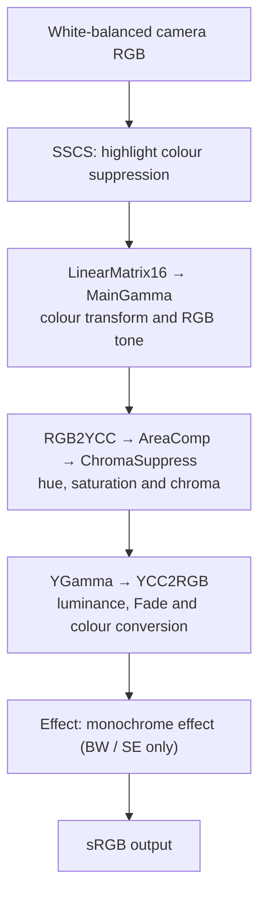

# Sony Look Bridge

Sony Creative Looks for photo and video

English | [中文](README.zh-CN.md)

Camera Raw still has no profiles for the A7M5's Creative Looks. This repository ports all 12 Creative Looks of the Sony α7 V (ILCE-7M5) to Capture One, Adobe Camera Raw / Lightroom and DxO PhotoLab, based on a reverse-engineered model of Sony Imaging Edge Edit — ST, VV, NT, PT, FL, VV2, IN, SH, BW, SE, FL2 and FL3.

The profiles reproduce the look's colour and tone. On the tested α7 V images, the remaining chroma difference compared with Edit is below what the eye can see.

v2.1.0 provides packs for 17 Sony cameras, with one ZIP per camera containing profiles for all three applications.

For the α7 V, video LUTs bring the photo looks to S-Log3 footage.

Video walkthrough: [YouTube (English)](https://youtu.be/LeK9HhhYosQ) · [Bilibili (Chinese)](https://www.bilibili.com/video/BV1VUH56pECK/)

## Camera coverage

Each camera pack contains profiles for Capture One, Camera Raw / Lightroom and DxO PhotoLab. Click a model to download; see the [release page][release] for all 17 packs.

| Series | Available cameras |
| --- | --- |
| α1 / α9 | [α1][sony-a1] · [α1 II][sony-a1-ii] · [α9 III][sony-a9-iii] |
| α7 | [α7 IV][sony-a7-iv] · [α7 V][sony-a7-v] · [α7S III][sony-a7s-iii] |
| α7R / α7C | [α7R V][sony-a7r-v] · [α7R VI][sony-a7r-vi] · [α7C II][sony-a7c-ii] · [α7CR][sony-a7cr] |
| α6000 | [α6700][sony-a6700] |
| Cinema Line | [FX2][sony-fx2] · [FX3][sony-fx3] · [FX30][sony-fx30] |
| RX / ZV | [RX1R III][sony-rx1r-iii] · [ZV-E1][sony-zv-e1] · [ZV-E10 II][sony-zv-e10-ii] |

The α7 V, α7R VI, FX2 and RX1R III packs have 12 native looks; the others have 10 native looks plus FL2 / FL3 ported from α7 V. New packs use the α7 V input calibration; ST and FL2 were tested in ACR on α7C II. See [camera notes](docs/cameras.en.md).

[sony-a1]: https://github.com/751K/sony-look-bridge/releases/download/v2.1.0/Sony-A1-Creative-Looks.zip
[sony-a1-ii]: https://github.com/751K/sony-look-bridge/releases/download/v2.1.0/Sony-A1-II-Creative-Looks.zip
[sony-a9-iii]: https://github.com/751K/sony-look-bridge/releases/download/v2.1.0/Sony-A9-III-Creative-Looks.zip
[sony-a7-iv]: https://github.com/751K/sony-look-bridge/releases/download/v2.1.0/Sony-A7-IV-Creative-Looks.zip
[sony-a7-v]: https://github.com/751K/sony-look-bridge/releases/download/v2.1.0/Sony-A7-V-Creative-Looks.zip
[sony-a7r-v]: https://github.com/751K/sony-look-bridge/releases/download/v2.1.0/Sony-A7R-V-Creative-Looks.zip
[sony-a7r-vi]: https://github.com/751K/sony-look-bridge/releases/download/v2.1.0/Sony-A7R-VI-Creative-Looks.zip
[sony-a7s-iii]: https://github.com/751K/sony-look-bridge/releases/download/v2.1.0/Sony-A7S-III-Creative-Looks.zip
[sony-a7c-ii]: https://github.com/751K/sony-look-bridge/releases/download/v2.1.0/Sony-A7C-II-Creative-Looks.zip
[sony-a7cr]: https://github.com/751K/sony-look-bridge/releases/download/v2.1.0/Sony-A7CR-Creative-Looks.zip
[sony-a6700]: https://github.com/751K/sony-look-bridge/releases/download/v2.1.0/Sony-A6700-Creative-Looks.zip
[sony-fx2]: https://github.com/751K/sony-look-bridge/releases/download/v2.1.0/Sony-FX2-Creative-Looks.zip
[sony-fx3]: https://github.com/751K/sony-look-bridge/releases/download/v2.1.0/Sony-FX3-Creative-Looks.zip
[sony-fx30]: https://github.com/751K/sony-look-bridge/releases/download/v2.1.0/Sony-FX30-Creative-Looks.zip
[sony-rx1r-iii]: https://github.com/751K/sony-look-bridge/releases/download/v2.1.0/Sony-RX1R-III-Creative-Looks.zip
[sony-zv-e1]: https://github.com/751K/sony-look-bridge/releases/download/v2.1.0/Sony-ZV-E1-Creative-Looks.zip
[sony-zv-e10-ii]: https://github.com/751K/sony-look-bridge/releases/download/v2.1.0/Sony-ZV-E10-II-Creative-Looks.zip
[release]: https://github.com/751K/sony-look-bridge/releases/tag/v2.1.0
[checksums]: https://github.com/751K/sony-look-bridge/releases/download/v2.1.0/SHA256SUMS.txt

## Results

The comparison below uses the ST look on one α7 V RAW file, DSC03591, with Sony Imaging Edge Edit as the reference. Capture One and Camera Raw both use the current ST colour tables, including SSCS, and as-shot white balance.


| Host | Mean lightness difference | Mean chromaticity difference |
| --- | ---: | ---: |
| Capture One | 0.24 | 0.58 |
| Camera Raw | 0.44 | 0.49 |

The errors are separated in CIELAB (D65): lightness is the absolute L* difference; chromaticity is the a*, b* plane distance Δab, capturing hue and chroma differences without the L* component. The table reports their pixelwise means over the shared valid area; lower is better.

Values are mean CIELAB (D65) lightness and chroma differences over the shared valid area. See [measurement notes](docs/measurements.md) for the method and other looks.

## Installation

The photo profiles are installed as below; the video LUTs are described in [Video LUTs](#video-luts). The steps use the α7 V filenames. Each camera ZIP includes its own installation instructions.

### Capture One

1. Copy `profiles/capture_one/SonyA7M5-Look-*.icc` to `~/Library/ColorSync/Profiles/`.
2. **Restart** Capture One, which caches profiles it has already loaded.
3. In *Base Characteristics*, set *ICC Profile* to `SonyA7M5 Look XX` and **Curve to Linear Response**.

### Camera Raw / Lightroom

1. Copy `profiles/camera_raw/SonyA7M5 Linear Base.dcp` to `~/Library/Application Support/Adobe/CameraRaw/CameraProfiles/`.
2. Copy `profiles/camera_raw/SonyA7M5 Look *.xmp` to `~/Library/Application Support/Adobe/CameraRaw/Settings/`.
3. Restart Photoshop / Lightroom and pick a look from the **Sony A7M5** group in the profile browser.
4. To match Sony's rendering exactly, turn off *Use Profile Corrections*. Adobe's lens profile also corrects vignetting, which Edit does not, so with it on the corners come out 20–27% brighter.

> ⚠️ Compatibility note: some Photoshop / Lightroom versions may not load these profiles correctly (for example, missing profiles or incorrect rendering). If that happens, update to a newer version.

On Windows the folders are `%APPDATA%\Adobe\CameraRaw\CameraProfiles` and `%APPDATA%\Adobe\CameraRaw\Settings` (untested).

### DxO PhotoLab

Requires **Elite** PhotoLab (the *LUT Grading* palette is Elite-only); tested with PhotoLab 10.1 on macOS. PhotoLab refers to the DCP and LUT files by path, so keep them in a permanent folder.

1. Copy `profiles/dxo/SonyA7M5 Linear Base v2.dcp` and `profiles/dxo/SonyA7M5 Look *.cube` to that folder.
2. Start from the **6 – No correction** preset, or make sure Smart Lighting, ClearView and Contrast are off. Lens corrections (distortion, chromatic aberration, lens sharpness) can be switched back on; they do not change the look's colour.
3. *Color/B&W Rendering*: Type **DCP Profile** → *Import DCP Profile…* → `SonyA7M5 Linear Base v2.dcp`. Set **DCP Curve to Adobe**, Intensity 100, and **Protect Saturated Colors to 0** (switch off its automatic mode).
4. *DxO PL Elite – LUT Grading*: LUT file → *Import (.cube)…* → `SonyA7M5 Look XX.cube`; **LUT Color Space ProPhoto RGB**, Intensity 100.
5. Optionally save these settings as a preset; switch looks by choosing another `.cube`.

### Scope

- Use the pack for your camera's RAW files. See [Camera coverage](#camera-coverage) for availability.
- The profiles replace only the look's colour and tone. DRO, sharpening and noise reduction are not included.

## Video LUTs

For the α7 V, a set of LUTs gives S-Log3 footage the colour and tone of the photo Creative Looks. **[Download Sony-A7-V-SLog3-Video-LUTs.zip](https://github.com/751K/sony-look-bridge/releases/download/v2.0.0/Sony-A7-V-SLog3-Video-LUTs.zip)** ([v2.0.0 release](https://github.com/751K/sony-look-bridge/releases/tag/v2.0.0)).

- **Contents**: 12 looks × 2 input gamuts, 24 `.cube` files with a 65³ grid. Files named `SLog3_SGamut3_` take S-Log3 / S-Gamut3; `SLog3_SGamut3Cine_` take S-Log3 / S-Gamut3.Cine. The output is Rec.709 / Gamma 2.4. IN, SH, FL2 and FL3 use the camera's default Fade (3, 6, 1, 1).
- **Exposure**: the LUTs expect footage metered at **+1⅔ EV** (+1.7 on the camera), with 18% grey at about 547 / 1023. For other exposures, adjust exposure before the LUT; for example, footage shot at +1 EV needs about +0.67 EV. The generator's `--exposure` option builds LUTs for a different convention.
- **Output level**: middle grey depends on the look. ST places 18% grey at about 0.607 (normalised Gamma 2.4 code value); FL, FL2 and FL3 at about 0.749, 0.714 and 0.705.
- **DaVinci Resolve**: in a DaVinci YRGB project without colour management, apply the LUT on the node that receives the S-Log3 clip, with exposure and white balance adjustments before it. The LUT already contains the log decode and the display transform, so do not add another log-to-Rec.709 or ACES output transform. Set the timeline and output colour space to Rec.709 Gamma 2.4 and use tetrahedral interpolation.

The LUTs connect S-Log3 to the photo look chain through a camera matrix measured from paired RAW and S-Log3 captures of the same screen chart. The `.cube` files are release assets; `profiles/video/` keeps the generation record (`manifest.json`) and the independent check (`validation.json`). To regenerate them:

```bash
python3 video/video_look.py /path/to/A7M5.ARW --write --eval
```

See [usage](profiles/video/README.md) and [calibration and generation](docs/video.md) (both Chinese).

## How it works

The project reproduces Sony's per-pixel colour and tone mapping from white-balanced camera RGB to sRGB. The main steps used to generate the profiles are:



SSCS precedes the look and is included in the generated profiles; spatial processing such as sharpening, noise reduction and DRO remains with the host. Edit also has an optional internal 3D LUT after YGamma. It is off by default and is separate from the LUTs this project generates for hosts. See the [full pipeline](docs/pipeline.md) (Chinese).

The project measures each application's input encoding and stores the mapping in an ICC, XMP or LUT. With Sony's look mapping *f* and the host input encoding *E*, the profile stores *f* ∘ *E*⁻¹. The figure shows the colour distributions after neutral development, ST and FL2:

<picture>
  <source media="(prefers-color-scheme: dark)" srcset="images/color_cube_en_dark.png">
  
</picture>

See [photo look reproduction and calibration](docs/photo_look.en.md) for the colour diagram and derivation. The [video LUT notes](docs/video.md) describe the measured bridge from S-Log3 to the photo look.

## Regenerating the profiles

### Requirements

- Python 3.11+ with `python3 -m pip install -r requirements.txt` in your chosen Python environment (a virtual environment is recommended).
- Any A7M5 ARW.
- **Imaging Edge Edit 4.0.00.10312 or 4.1.00.03062** installed locally (macOS).
- Optional: a Rust toolchain (`cargo`) for the accelerated `--rust` decoder, and on macOS the Xcode Command Line Tools for the Metal GPU path (`--metal`). The NumPy path needs neither; the one-time LUTs are cached under `~/.cache/sonylook` (`SONYLOOK_CACHE=0` disables, `SONYLOOK_CACHE_DIR` moves it).

A few constant tables used by the look chain are read at run time from your own Edit installation (`sonylook/edit_binary.py`); examples are the hue atan table and the contrast curve family. This repository contains no Sony binaries or data. The script checks the SHA-256 of the arm64 slice, because table addresses differ between builds. Both 4.0.00.10312 and 4.1.00.03062 are supported: the project keeps the 4.0 addresses and `edit_binary.py` maps them to the installed build. Set `SONY_EDIT_BINARY` to use a different path.

### Commands

Build the Capture One profiles:

```bash
python3 capture_one/c1_look_profile.py /path/to/A7M5.ARW
```

Build the Camera Raw profiles:

```bash
python3 camera_raw/acr_look.py /path/to/A7M5.ARW --write
```

Build the DxO PhotoLab LUTs (`--eval` also prints the interpolation error on the ARW):

```bash
python3 dxo/dxo_look.py /path/to/A7M5.ARW --write
```

Render previews directly with the look chain:

```bash
python3 sonylook/sony_render.py /path/to/A7M5.ARW Standard FL2 --scale 4
```

Regenerating from DSC03591 reproduces the files in `profiles/` byte for byte.

### Viewer super-resolution

See [technical notes](docs/sdm.md) on Viewer Extended Hi-Res inputs, tiling and export.

### Recalibration

See [recalibration notes](docs/recalibration.en.md) for the synthetic chart and host input measurements.

## ARW decoder

`sonylook/sony_decode.py` reproduces Edit's whole RAW development and writes the image Edit exports, using the develop settings stored in the ARW:

```text
RAW → [RawNR] → ITP → [DRO] → [GeoCorr] → SSCS → LinearMatrix16 → MainGamma
    → RGB2YCC → AreaComp → ChromaSuppress → Sharpness → YGamma → [HueSaturation]
    → Spica → YCC2RGB → [Marble] → [Effect] → [ToneCurve] → [ShadeCorrection]
```

Stages in brackets run when the settings enable them. The output is the decoder rectangle (7008×4672 on the α7 V) in sRGB or Adobe RGB, written as TIFF, JPEG or PNG. See [pipeline notes](docs/pipeline.md) (Chinese) for every stage and parameter.

### Three implementations

| Implementation | Platform | Coverage | Role |
| --- | --- | --- | --- |
| Python / NumPy | any | every stage | reference and default backend |
| Rust (`--rust`) | any, needs `cargo` | raw reading (lossless compressed ARW), RawNR, ITP, DRO, GeoCorr, SSCS, the look chain, Sharpness → YCC2RGB, Marble and table construction; Effect, ToneCurve and ShadeCorrection stay on NumPy | multithreaded CPU backend |
| Metal (`--metal`) | macOS | every stage after the raw read | GPU backend; stages exchange GPU-resident arrays without copies |

The Rust and Metal outputs are bit-identical to NumPy, verified stage by stage and on whole images. The one exception is Metal ITP: a few direction-map sums use float32 instead of float64, so on synthetic full-range noise a handful of values can differ by 1; no difference has appeared on real ARWs. The two backends combine: `--rust --metal` reads the raw with Rust and runs the rest on the GPU.

```bash
python3 sonylook/sony_decode.py /path/to/A7M5.ARW --out out.tif                # NumPy
python3 sonylook/sony_decode.py /path/to/A7M5.ARW --rust --out out.tif         # Rust
python3 sonylook/sony_decode.py /path/to/A7M5.ARW --rust --metal --out out.tif # Rust + Metal
```

From Python, `decode(path, rust=True, metal=True)` returns the image as a uint16 array. For batches, call `decode()` repeatedly in one process: Metal initialisation, shader compilation and the buffer pool are set up on the first call only.

### Speed

Mac mini (Apple M6, 16 GB), one 7008×4672 image, decoded again in the same process:

| File | NumPy | Rust | Metal | Rust + Metal |
| --- | ---: | ---: | ---: | ---: |
| DSC03591 (NR, DRO off) | 28.1 s | 1.7 s | 0.40 s | 0.15 s |
| DSC05740 (BW, NR, DRO on) | 37.0 s | 2.8 s | 0.48 s | 0.19 s |

Metal alone reads the raw with rawpy (about 0.3 s); with `--rust` that takes about 0.02 s. The first decode of a new file in a process adds about 0.1–0.3 s for reading the file and its metadata. See [Rust notes](rust/README.md) and [Metal notes](docs/metal.md) (Chinese) for building, per-stage timings and verification.

## Repository layout

| Folder | Contents |
| --- | --- |
| `profiles/` | Generated photo profiles and video LUT generation records |
| `chart/` | Synthetic chart: `SonyChart.ARW` (opens in Capture One and Camera Raw), patch definitions `SonyChart.json`, preview image |
| `sonylook/` | Python port of Sony's look chain and front end, ARW and Edit readers. Also ports of RawNR, DRO, sharpening / Spica, Marble, lens geometry correction (none used by the profiles) and the BW/SE Effect stage (used), plus the end-to-end decoder `sony_decode.py` |
| `rust/` | Optional Rust core (`sonylook_core`): raw reading, RawNR, ITP, DRO, GeoCorr, SSCS, fused render bands, Marble and table builders. See `rust/README.md` |
| `metal/` | Optional Metal GPU implementation of the decoder stages (macOS): the Objective-C bridge and the shaders. See [Metal notes](docs/metal.md) |
| `tests/` | Differential checks of the Metal stages and the Rust ports against the reference |
| `capture_one/` | Capture One profile generation, synthetic chart, measurement and comparison |
| `camera_raw/` | Camera Raw table format, DCP read/write, profile generation, measurement and comparison |
| `dxo/` | DxO PhotoLab model of the LUT input (`dxo_model.py`), probe and base-DCP generation, LUT generation |
| `camera_packs/` | Per-camera pack generator (`build_packs.py`) and the installation notes included in each ZIP |
| `video/` | S-Log3 input transforms, sensor-matrix calibration, video LUT generation and tests |
| `docs/` | [Documentation index](docs/README.md): pipeline, host calibrations, measurement protocols and local research references. Evidence files and test exports are kept outside the repository |

## Notes

- This project is not affiliated with Sony, Capture One, Adobe or DxO. All names and trademarks belong to their owners.
- The project achieves interoperability by analysing software behaviour. The repository contains no binaries, decompiled code or data extracted from that software. The constants it needs are read on the user's machine from the user's own installation.
- The ColorMatrix values in the Camera Raw profiles come from Adobe Standard's A7M5 profile, so that Camera Raw's white balance behaves unchanged. The DxO base DCP uses Adobe Standard's ColorMatrix and D65 ForwardMatrix for the same reason.
- `dxo/dxo_model.py` re-implements PhotoLab's highlight recovery from its observed behaviour and contains a few values measured from PhotoLab while it runs (the DxO Wide Gamut matrices, the highlight white level); it contains no DxO code or files.

## License

- The code, documentation and the work of generating the profiles are released under the [MIT License](LICENSE).
- The profiles are provided as is. Third-party data contained in them (Sony's look parameters, Adobe's ColorMatrix values) is not covered by this license, and the project claims no rights to it.
