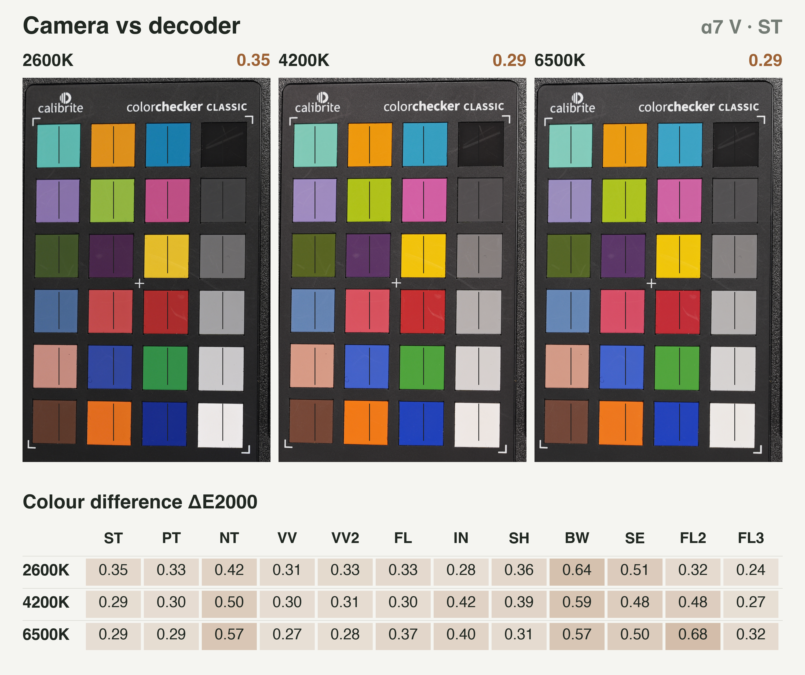
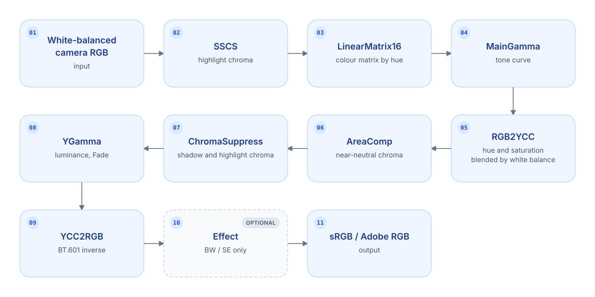

# Sony Look Bridge

[中文](README.zh-CN.md) | English

This project reproduces the photo development and Creative Looks of Sony Imaging Edge Edit in Python and turns them into profiles and LUTs for post-processing software, so that RAW files look as they do in the camera in Capture One, Camera Raw / Lightroom, DxO PhotoLab and DaVinci Resolve.

- **Photo**: Creative Look profiles for 17 Sony cameras, each in Capture One, Camera Raw / Lightroom and DxO PhotoLab formats.
- **Video**: S-Log3 LUTs for the α7 V, 12 looks × 2 input gamuts × 3 white-balance variants, plus DaVinci Resolve DCTLs with a white-balance control.

Related presentations: [Bilibili](https://www.bilibili.com/video/BV1VUH56pECK/) · [YouTube (English)](https://youtu.be/LeK9HhhYosQ)

The figure uses a ColorChecker Passport shot with the α7 V at 2600K, 4200K and 6500K. It compares the HEIF written by the camera with this repository's decoder, which uses the camera settings recorded in the ARW. The charts show the ST look: the left half of every patch is the camera HEIF and the right half the decoder, with the three charts brought to the same white-patch brightness. The table gives the mean ΔE2000 over the 50 patches of both pages. FL2 and FL3 are decoded with Edit's default Fade, which differs from the camera's setting, hence the larger difference. See [Photo profiles § Validation](docs/photo.md#验证) for the profiles themselves.

## Download

Photo profiles are downloaded per camera; each ZIP holds the profiles for all three applications and installation notes. See the [release page][release] for all cameras and release notes.

| Series | Cameras |
| --- | --- |
| α1 / α9 | [α1][sony-a1] · [α1 II][sony-a1-ii] · [α9 III][sony-a9-iii] |
| α7 | [α7 IV][sony-a7-iv] · [α7 V][sony-a7-v] · [α7S III][sony-a7s-iii] |
| α7R / α7C | [α7R V][sony-a7r-v] · [α7R VI][sony-a7r-vi] · [α7C II][sony-a7c-ii] · [α7CR][sony-a7cr] |
| α6000 | [α6700][sony-a6700] |
| Cinema Line | [FX2][sony-fx2] · [FX3][sony-fx3] · [FX30][sony-fx30] |
| RX / ZV | [RX1R III][sony-rx1r-iii] · [ZV-E1][sony-zv-e1] · [ZV-E10 II][sony-zv-e10-ii] |

Video LUTs: **[Sony-A7-V-SLog3-Video-LUTs.zip][video-luts]**; see the [video LUT guide](profiles/video/README.md).

The α7 V, α7R VI, FX2 and RX1R III have 12 native looks; the other cameras have 10 native looks plus FL2 and FL3 ported from the α7 V. The α7 V profiles are also kept in `profiles/` in this repository.

[sony-a1]: https://github.com/751K/sony-look-bridge/releases/download/v4.0.0/Sony-A1-Creative-Looks.zip

[sony-a1-ii]: https://github.com/751K/sony-look-bridge/releases/download/v4.0.0/Sony-A1-II-Creative-Looks.zip

[sony-a9-iii]: https://github.com/751K/sony-look-bridge/releases/download/v4.0.0/Sony-A9-III-Creative-Looks.zip

[sony-a7-iv]: https://github.com/751K/sony-look-bridge/releases/download/v4.0.0/Sony-A7-IV-Creative-Looks.zip

[sony-a7-v]: https://github.com/751K/sony-look-bridge/releases/download/v4.0.0/Sony-A7-V-Creative-Looks.zip

[sony-a7r-v]: https://github.com/751K/sony-look-bridge/releases/download/v4.0.0/Sony-A7R-V-Creative-Looks.zip

[sony-a7r-vi]: https://github.com/751K/sony-look-bridge/releases/download/v4.0.0/Sony-A7R-VI-Creative-Looks.zip

[sony-a7s-iii]: https://github.com/751K/sony-look-bridge/releases/download/v4.0.0/Sony-A7S-III-Creative-Looks.zip

[sony-a7c-ii]: https://github.com/751K/sony-look-bridge/releases/download/v4.0.0/Sony-A7C-II-Creative-Looks.zip

[sony-a7cr]: https://github.com/751K/sony-look-bridge/releases/download/v4.0.0/Sony-A7CR-Creative-Looks.zip

[sony-a6700]: https://github.com/751K/sony-look-bridge/releases/download/v4.0.0/Sony-A6700-Creative-Looks.zip

[sony-fx2]: https://github.com/751K/sony-look-bridge/releases/download/v4.0.0/Sony-FX2-Creative-Looks.zip

[sony-fx3]: https://github.com/751K/sony-look-bridge/releases/download/v4.0.0/Sony-FX3-Creative-Looks.zip

[sony-fx30]: https://github.com/751K/sony-look-bridge/releases/download/v4.0.0/Sony-FX30-Creative-Looks.zip

[sony-rx1r-iii]: https://github.com/751K/sony-look-bridge/releases/download/v4.0.0/Sony-RX1R-III-Creative-Looks.zip

[sony-zv-e1]: https://github.com/751K/sony-look-bridge/releases/download/v4.0.0/Sony-ZV-E1-Creative-Looks.zip

[sony-zv-e10-ii]: https://github.com/751K/sony-look-bridge/releases/download/v4.0.0/Sony-ZV-E10-II-Creative-Looks.zip

[release]: https://github.com/751K/sony-look-bridge/releases/tag/v4.0.0

[video-luts]: https://github.com/751K/sony-look-bridge/releases/download/v4.0.0/Sony-A7-V-SLog3-Video-LUTs.zip

## Choosing a variant

The camera changes a look's colours with the as-shot white balance: it uses the warm-light parameters at about 4100K and below and the daylight parameters at about 5400K and above, blending in between (α7 V camera white-balance setting; other cameras differ slightly). A profile cannot read the white balance, so each colour look comes in these variants:

| Variant | Name | Behaviour | Applications |
| --- | --- | --- | --- |
| Daylight | `Look XX` | Daylight parameters | Capture One, Camera Raw / Lightroom, DxO PhotoLab |
| Warm | `Look XX Warm` | Warm-light parameters | Capture One, Camera Raw / Lightroom, DxO PhotoLab |
| Auto | `Look XX Auto` | Follows the white balance: matches Warm at about 4150K and below and Daylight at about 5500K and above, blending smoothly in between | Camera Raw / Lightroom only |

- In Camera Raw and Lightroom, use Auto; the look does not need to be changed when the colour temperature is adjusted.
- In Capture One and DxO PhotoLab, use Warm for photos shot below about 4700K and Daylight otherwise.
- BW renders the same at every white balance and has a single version; so does SE on the α7 V.

The video LUTs are likewise split into daylight, 4200K and warm sets by the white balance of the footage; the DaVinci Resolve DCTLs blend continuously between the three.

## Installation

The steps use the α7 V file names; for other cameras, replace `SonyA7M5` with the camera's prefix.

### Capture One

1. Copy `SonyA7M5-Look-*.icc` to `~/Library/ColorSync/Profiles/`.
2. **Restart** Capture One, which caches the profiles it has loaded.
3. In *Base Characteristics*, set *ICC Profile* to `SonyA7M5 Look XX` and **Curve to Linear Response**.

### Camera Raw / Lightroom

1. Copy `SonyA7M5 Linear Base.dcp` and all `SonyA7M5 Auto Base *.dcp` to `~/Library/Application Support/Adobe/CameraRaw/CameraProfiles/`.
2. Copy `SonyA7M5 Look *.xmp` to `~/Library/Application Support/Adobe/CameraRaw/Settings/`.
3. Restart Photoshop or Lightroom and select a look from the **Sony A7M5** group in the profile browser. The `Auto Base` DCPs are used by the Auto looks and do not need to be selected.

Some Photoshop / Lightroom versions do not load these profiles correctly. Lightroom Classic 15.4.1, for example, lists the looks but renders all of them like the Linear Base; Lightroom Classic 15.6 and Camera Raw 18.7 apply them correctly. If this happens, update to a newer version.

### DxO PhotoLab

1. Save `SonyA7M5 Linear Base v2.dcp` and `SonyA7M5 Look *.cube` in a fixed folder. PhotoLab refers to the files by path and needs them imported again if they move.
2. Apply the **6 – No correction** preset, or make sure Smart Lighting, ClearView and Contrast are off. Lens corrections (distortion, chromatic aberration, lens sharpness) may be turned back on; they do not change the look's colour.
3. In *Color/B&W Rendering*, set the type to **DCP Profile** and choose `SonyA7M5 Linear Base v2.dcp` via *Import DCP Profile…*; set **DCP Curve to Adobe**, Intensity 100 and **Protect Saturated Colors to 0** with its automatic mode off.
4. In *LUT Grading*, choose `SonyA7M5 Look XX.cube` via *Import (.cube)…* and set **LUT Color Space to ProPhoto RGB**, Intensity 100.
5. The settings may be saved as a preset; to change looks, select another `.cube`.

### DaVinci Resolve

See the [video LUT guide](profiles/video/README.md).

## Limitations

- Only the α7 V has been validated on a real ColorChecker. The other cameras are built from sample-file parameters, and their Warm and Auto profiles are less accurate under warm light than the α7 V's.
- Capture One and DxO PhotoLab have only the daylight and warm states; at intermediate colour temperatures, choose by eye.
- Under greenish light such as fluorescent tubes, the camera blends in a third parameter set that none of the profiles contains.
- The profiles contain only per-pixel colour and tone; noise reduction, sharpening and DRO are left to each application.

See [Photo profiles § Limitations](docs/photo.md#局限) for details.

## How it works and development

This repository reproduces Edit's processing stage by stage and compares each stage bit for bit with Edit's own functions. `sonylook/sony_decode.py` decodes a complete image with the development settings stored in the ARW. Only the Python implementation is kept here; the complete decoder with Rust and Metal acceleration is maintained in the separate [sony-arw-decoder](https://github.com/751K/sony-arw-decoder) repository.

The documentation is written in Chinese:

| Document | Contents |
| --- | --- |
| [Photo profiles](docs/photo.md) | How the looks become profiles for the three applications, the variants, validation and limitations |
| [Video LUTs](docs/video.md) | From S-Log3 to the photo look, ColorChecker calibration, DCTLs and validation |
| [Processing pipeline](docs/pipeline.md) | Order, parameters and implementation of every stage in Edit |
| [Development and releases](docs/development.md) | Build environment and commands, recalibration, release workflow |

| Folder | Contents |
| --- | --- |
| `profiles/` | α7 V photo profiles and the video LUT generation records |
| `sonylook/` | Python port of Edit's look chain and front end, ARW and Edit readers, full-image decoder |
| `capture_one/`, `camera_raw/`, `dxo/` | Profile generation, input calibration and measurement for the three applications |
| `camera_packs/` | Per-camera packs and the release build |
| `video/` | Video LUT and DCTL generation, calibration and tests |
| `chart/` | Synthetic chart ARW for calibration |
| `docs/` | Documentation |

## Notes

- This project is not affiliated with Sony, Capture One, Adobe or DxO. All names and trademarks belong to their owners.
- The ColorMatrix and ForwardMatrix values in the profiles come from each camera's Adobe Standard profile, so that Camera Raw and PhotoLab keep their white-balance behaviour.
- `dxo/dxo_model.py` re-implements PhotoLab's highlight recovery from its observed behaviour, with a few values measured while PhotoLab runs; the repository contains no DxO code or files.

## License

- The code, documentation and the work of generating the profiles are released under the [MIT License](LICENSE).
- The profiles are provided as is. Third-party data in them (Sony's look parameters, Adobe's colour matrices) is not covered by this license, and the project claims no rights to it.
