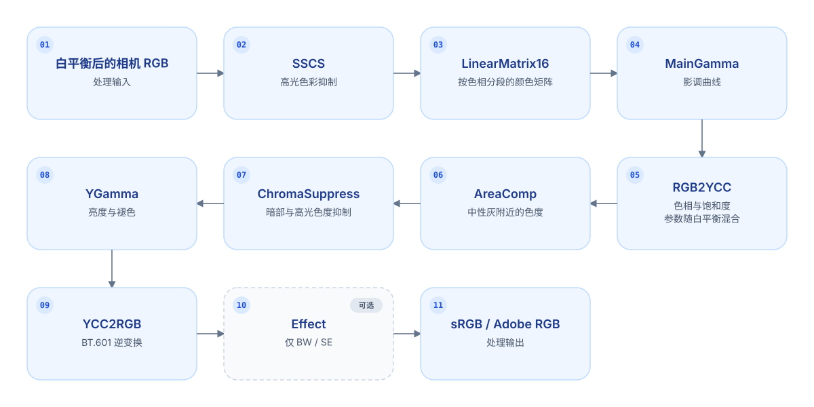

# Sony Look Bridge

[English](README.md) | 中文

## 仓库概述

本仓库使用 Python 复现了 Sony Imaging Edge Edit 的照片显影与 Creative Look 实现，并将复现得到的色彩映射转换为后期软件可用的配置文件和 LUT。

当前覆盖 α7 V 的 12 种 Creative Look，并提供 17 款 Sony 机型的三套照片配置。α7 V 另提供 12 种外观 × 2 种输入色域的视频 LUT。

| LUT 文件                         | 用途                                       |
| -------------------------------- | ------------------------------------------ |
| Capture One ICC                  | 照片外观配置文件                           |
| Camera Raw / Lightroom DCP + XMP | 照片配置文件与 RGBTable                    |
| DxO PhotoLab `.cube`             | 照片 LUT Grading                           |
| S-Log3 `.cube`                   | DaVinci Resolve 等后期软件的 Creative Look |

相关介绍：[Bilibili](https://www.bilibili.com/video/BV1VUH56pECK/) · [YouTube（英文）](https://youtu.be/LeK9HhhYosQ)

## Edit 的色彩管线



完整阶段顺序和参数见[处理管线](docs/pipeline.md)。

下图展示中性显影、ST 和 FL2 对颜色分布的影响：

<picture>
  <source media="(prefers-color-scheme: dark)" srcset="images/color_cube_zh_dark.png">
  
</picture>

色彩映射图及完整推导见[照片外观与宿主配置](docs/photo.md)；视频链使用实拍矩阵连接 S-Log3 与照片外观，见[视频 LUT 标定](docs/video.md)。

### ARW 解码

`sonylook/sony_decode.py` 在逐像素外观链之外进一步实现 RawNR、ITP、DRO、镜头几何校正、锐化 / Spica、Marble、ToneCurve 和 ShadeCorrection。解码器按照 ARW 中保存的显影设置输出完整图像：

```text
RAW → [RawNR] → ITP → [DRO] → [GeoCorr] → SSCS → LinearMatrix16 → MainGamma
    → RGB2YCC → AreaComp → ChromaSuppress → Sharpness → YGamma → [HueSaturation]
    → Spica → YCC2RGB → [Marble] → [Effect] → [ToneCurve] → [ShadeCorrection]
```

方括号中的阶段按设置运行。输出为解码器矩形（α7 V 为 7008×4672），色彩空间为 sRGB 或 Adobe RGB，格式为 TIFF、JPEG 或 PNG。各阶段的实现与参数见[处理管线](docs/pipeline.md)。

本仓库只保留 Python 实现。包含 Rust、Metal 加速的独立完整解码器使用通用名称
[sony-arw-decoder](https://github.com/751K/sony-arw-decoder)，作为另一个仓库维护。

## 验证结果


## 兼容性

每个机型包均包含 Capture One、Camera Raw / Lightroom 和 DxO PhotoLab 配置。可通过机型名称下载对应文件；[全部 17 个包及版本说明][release]。

| 系列        | 可下载的机型                                                                            |
| ----------- | --------------------------------------------------------------------------------------- |
| α1 / α9     | [α1][sony-a1] · [α1 II][sony-a1-ii] · [α9 III][sony-a9-iii]                             |
| α7          | [α7 IV][sony-a7-iv] · [α7 V][sony-a7-v] · [α7S III][sony-a7s-iii]                       |
| α7R / α7C   | [α7R V][sony-a7r-v] · [α7R VI][sony-a7r-vi] · [α7C II][sony-a7c-ii] · [α7CR][sony-a7cr] |
| α6000       | [α6700][sony-a6700]                                                                     |
| Cinema Line | [FX2][sony-fx2] · [FX3][sony-fx3] · [FX30][sony-fx30]                                   |
| RX / ZV     | [RX1R III][sony-rx1r-iii] · [ZV-E1][sony-zv-e1] · [ZV-E10 II][sony-zv-e10-ii]           |

α7 V、α7R VI、FX2、RX1R III 包含 12 种原生外观，其余机型包含 10 种原生外观及移植的 FL2 / FL3。新增机型沿用 α7 V 输入校准；α7C II 已在 ACR 验证 ST 和 FL2。每个 ZIP 都包含对应机型的安装说明。

[sony-a1]: https://github.com/751K/sony-look-bridge/releases/download/v2.2.0/Sony-A1-Creative-Looks.zip

[sony-a1-ii]: https://github.com/751K/sony-look-bridge/releases/download/v2.2.0/Sony-A1-II-Creative-Looks.zip

[sony-a9-iii]: https://github.com/751K/sony-look-bridge/releases/download/v2.2.0/Sony-A9-III-Creative-Looks.zip

[sony-a7-iv]: https://github.com/751K/sony-look-bridge/releases/download/v2.2.0/Sony-A7-IV-Creative-Looks.zip

[sony-a7-v]: https://github.com/751K/sony-look-bridge/releases/download/v2.2.0/Sony-A7-V-Creative-Looks.zip

[sony-a7r-v]: https://github.com/751K/sony-look-bridge/releases/download/v2.2.0/Sony-A7R-V-Creative-Looks.zip

[sony-a7r-vi]: https://github.com/751K/sony-look-bridge/releases/download/v2.2.0/Sony-A7R-VI-Creative-Looks.zip

[sony-a7s-iii]: https://github.com/751K/sony-look-bridge/releases/download/v2.2.0/Sony-A7S-III-Creative-Looks.zip

[sony-a7c-ii]: https://github.com/751K/sony-look-bridge/releases/download/v2.2.0/Sony-A7C-II-Creative-Looks.zip

[sony-a7cr]: https://github.com/751K/sony-look-bridge/releases/download/v2.2.0/Sony-A7CR-Creative-Looks.zip

[sony-a6700]: https://github.com/751K/sony-look-bridge/releases/download/v2.2.0/Sony-A6700-Creative-Looks.zip

[sony-fx2]: https://github.com/751K/sony-look-bridge/releases/download/v2.2.0/Sony-FX2-Creative-Looks.zip

[sony-fx3]: https://github.com/751K/sony-look-bridge/releases/download/v2.2.0/Sony-FX3-Creative-Looks.zip

[sony-fx30]: https://github.com/751K/sony-look-bridge/releases/download/v2.2.0/Sony-FX30-Creative-Looks.zip

[sony-rx1r-iii]: https://github.com/751K/sony-look-bridge/releases/download/v2.2.0/Sony-RX1R-III-Creative-Looks.zip

[sony-zv-e1]: https://github.com/751K/sony-look-bridge/releases/download/v2.2.0/Sony-ZV-E1-Creative-Looks.zip

[sony-zv-e10-ii]: https://github.com/751K/sony-look-bridge/releases/download/v2.2.0/Sony-ZV-E10-II-Creative-Looks.zip

[release]: https://github.com/751K/sony-look-bridge/releases/tag/v2.2.0

[checksums]: https://github.com/751K/sony-look-bridge/releases/download/v2.2.0/SHA256SUMS.txt

## 使用说明

以下为照片配置的安装步骤，视频 LUT 见[视频 LUT](#视频-lut)。步骤使用 α7 V 的文件名。各机型 ZIP 内附对应的安装说明。

每个彩色外观另有名称以 Warm 结尾的暖光版本。相机在约 3700K 以下的白平衡下采用暖光色彩参数、约 5400K 以上采用日光参数，因此低色温照片宜使用暖光版，详见[照片管线 §4.3](docs/pipeline.md)。

### Capture One

1. 将 `profiles/capture_one/SonyA7M5-Look-*.icc` 复制至 `~/Library/ColorSync/Profiles/`，随后**重新启动** Capture One。Capture One 会缓存已加载的配置。
2. 在 Base Characteristics 中，将 ICC Profile 设为 `SonyA7M5 Look XX`，并将 **Curve 设为 Linear Response**。

### Camera Raw / Lightroom

1. 将 `profiles/camera_raw/SonyA7M5 Linear Base.dcp` 复制至 `~/Library/Application Support/Adobe/CameraRaw/CameraProfiles/`。
2. 将 `profiles/camera_raw/SonyA7M5 Look *.xmp` 复制至 `~/Library/Application Support/Adobe/CameraRaw/Settings/`。
3. 重新启动 Photoshop / Lightroom，并在配置文件浏览器的 **Sony A7M5** 分组中选择外观。

⚠️ 兼容性提示：部分 Photoshop / Lightroom 版本可能无法正确加载这些配置（例如配置文件不显示或效果异常）。如果遇到兼容问题，建议更新到较新版本。

### DxO PhotoLab

1. 将 `profiles/dxo/SonyA7M5 Linear Base v2.dcp` 和 `profiles/dxo/SonyA7M5 Look *.cube` 复制至前文指定目录。
2. 应用 **6 – 无校正** 预设；若不使用预设，应确认 Smart Lighting、ClearView 和对比度均已关闭。镜头校正（畸变、色差、镜头锐度）可重新开启，不影响外观颜色。
3. **颜色渲染（Color/B&W Rendering）**：将类型设为 **DCP 配置文件**，选择 *导入 DCP 配置文件…* 并指定 `SonyA7M5 Linear Base v2.dcp`；将 DCP 曲线设为 **Adobe**、强度设为 100、**饱和色保护**设为 0（关闭自动模式）。
4. **LUT**：在 **DxO PL Elite – LUT Grading** 面板中选择 LUT 文件旁的 *导入（.cube）…*，指定 `SonyA7M5 Look XX.cube`；将 **LUT 色彩空间**设为 ProPhoto RGB、强度设为 100。
5. 可将上述设置保存为预设；后续更换外观时，仅需更换 `.cube` 文件。

### 视频 LUT

**[下载 Sony-A7-V-SLog3-Video-LUTs.zip](https://github.com/751K/sony-look-bridge/releases/download/v2.0.0/Sony-A7-V-SLog3-Video-LUTs.zip)**（[v2.0.0 发布页](https://github.com/751K/sony-look-bridge/releases/tag/v2.0.0)）。

针对视频内容，本项目提供基于A7M5所制作的视频LUT，并针对S-Gamut3 和 S-Gamut3.Cine 分别提供不同版本。视频 LUT 使用 Rec.709 / Gamma 2.4 作为输出。

详见[使用说明](profiles/video/README.md)和[标定与生成](docs/video.md)。

## 目录

| 目录            | 内容                                                                                                                                                                                                  |
| --------------- | ----------------------------------------------------------------------------------------------------------------------------------------------------------------------------------------------------- |
| `profiles/`     | 照片配置及视频 LUT 的生成记录                                                                                                                                                                         |
| `chart/`        | 合成色卡：`SonyChart.ARW`（可由 Capture One / Camera Raw 直接打开）、色块定义 `SonyChart.json`、预览图                                                                                                |
| `sonylook/`     | Sony 外观链与前端的 Python 移植，以及 ARW / Edit 读取器。另含 RawNR、DRO、锐化 / Spica、Marble、镜头几何校正（不参与配置生成）、BW/SE 的 Effect 阶段（参与配置生成），以及整图解码器 `sony_decode.py` |
| `capture_one/`  | C1 配置生成、合成色卡、测量与对比                                                                                                                                                                     |
| `camera_raw/`   | ACR 表格式、DCP 读写、配置生成、测量与对比                                                                                                                                                            |
| `dxo/`          | DxO PhotoLab 的 LUT 输入模型（`dxo_model.py`）、探针和底座 DCP 生成、LUT 生成                                                                                                                         |
| `camera_packs/` | 各机型配置包生成器、机型元数据，以及生成 ZIP 安装说明所用的共享模板                                                                                                                                   |
| `video/`        | S-Log3 输入转换、传感器矩阵标定、视频 LUT 生成和测试                                                                                                                                                  |
| `docs/`         | [文档导航](docs/README.md)：照片配置、处理管线和视频 LUT                                                                                                                                              |

## 说明

- 本项目与 Sony、Capture One、Adobe、DxO 均无关联，相关名称和商标归各自所有者所有。
- 配置文件中的 ColorMatrix 数值取自 Adobe Standard 的 A7M5 配置，用于让 ACR 的白平衡行为保持不变。DxO 的底座 DCP 出于同样的原因，用了 Adobe Standard 的 ColorMatrix 和 D65 ForwardMatrix。
- `dxo/dxo_model.py` 按观测到的行为重新实现了 PhotoLab 的高光恢复，并包含几个在 PhotoLab 运行时测得的数值（DxO Wide Gamut 矩阵、高光白点）；不包含 DxO 的代码或文件。

## 许可

- 代码、文档和生成配置的工作以 [MIT 许可证](LICENSE) 发布。
- 配置文件按原样提供。其中源自第三方的数据（Sony 的外观参数、Adobe 的 ColorMatrix 数值）不在本许可的授权范围内，本项目也不对其主张任何权利。
