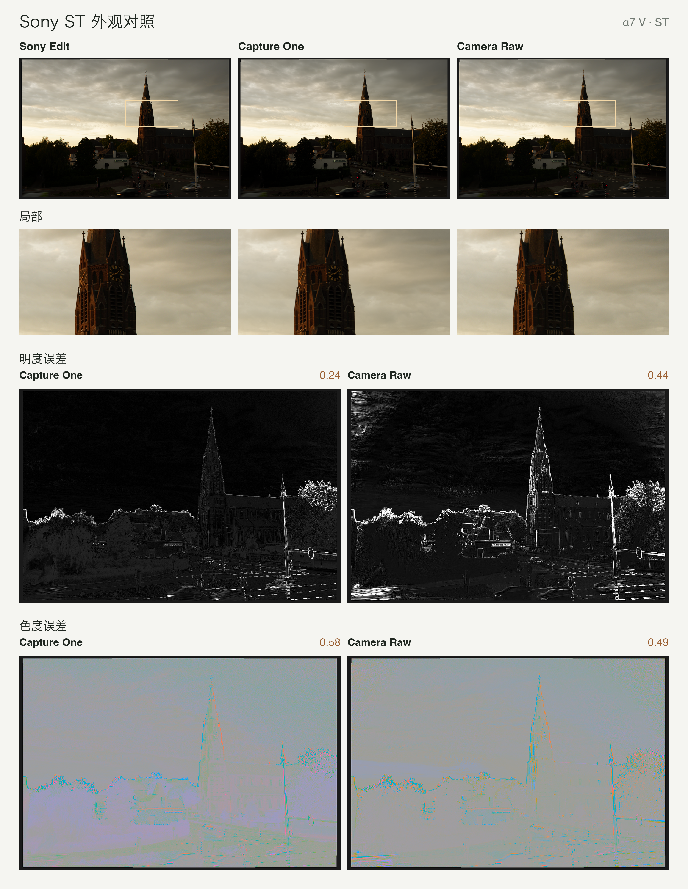
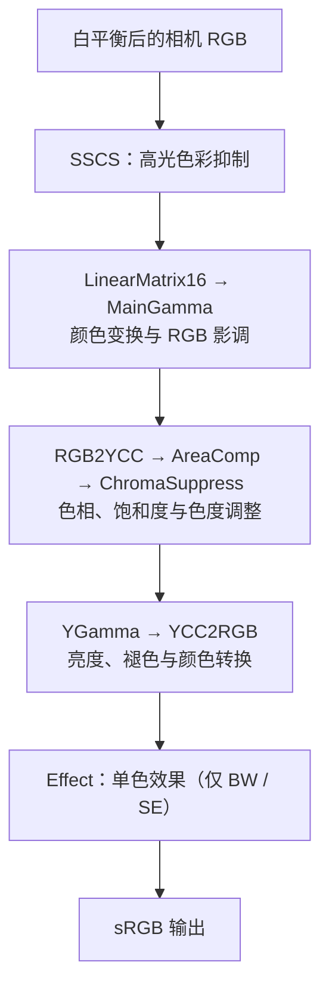

# Sony Look Bridge

Sony Creative Look 的照片配置与视频 LUT

[English](README.md) | 中文

天下苦创意风格久矣，CameraRaw 内迟迟没有上线A7M5的创意风格文件

本仓库通过逆向Sony Image Edit，把 Sony α7 V（ILCE-7M5）的 12 种 Creative Look移植成 Capture One、Camera Raw / Lightroom 和 DxO PhotoLab 的配置，并在 α7 V 样张上通过对比检验，色度上基本没有差异。

v2.1.0 提供 17 款 Sony 机型的配置，每台机型各有一个包含三款软件配置的 ZIP。

α7 V 还提供视频 LUT，将照片外观应用到 S-Log3 素材。

讲解视频：[Bilibili](https://www.bilibili.com/video/BV1VUH56pECK/) · [YouTube（英文）](https://youtu.be/LeK9HhhYosQ)

## 机型覆盖

每个机型包包含 Capture One、Camera Raw / Lightroom 和 DxO PhotoLab 配置。点击机型下载；[全部 17 个包及版本说明][release]。

| 系列 | 可下载的机型 |
| --- | --- |
| α1 / α9 | [α1][sony-a1] · [α1 II][sony-a1-ii] · [α9 III][sony-a9-iii] |
| α7 | [α7 IV][sony-a7-iv] · [α7 V][sony-a7-v] · [α7S III][sony-a7s-iii] |
| α7R / α7C | [α7R V][sony-a7r-v] · [α7R VI][sony-a7r-vi] · [α7C II][sony-a7c-ii] · [α7CR][sony-a7cr] |
| α6000 | [α6700][sony-a6700] |
| Cinema Line | [FX2][sony-fx2] · [FX3][sony-fx3] · [FX30][sony-fx30] |
| RX / ZV | [RX1R III][sony-rx1r-iii] · [ZV-E1][sony-zv-e1] · [ZV-E10 II][sony-zv-e10-ii] |

α7 V、α7R VI、FX2、RX1R III 包含 12 种原生外观，其余机型包含 10 种原生外观及移植的 FL2 / FL3。新增机型沿用 α7 V 输入校准；α7C II 已在 ACR 验证 ST 和 FL2。每个 ZIP 都包含对应机型的安装说明。

[sony-a1]: https://github.com/751K/sony-look-bridge/releases/download/v2.1.0/Sony-A1-Creative-Looks.zip
[sony-a1-ii]: https://github.com/751K/sony-look-bridge/releases/download/v2.1.0/Sony-A1-II-Creative-Looks.zip
[sony-a9-iii]: https://github.com/751K/sony-look-bridge/releases/download/v2.1.0/Sony-A9-III-Creative-Looks.zip
[sony-a7-iv]: https://github.com/751K/sony-look-bridge/releases/download/v2.1.0/Sony-A7-IV-Creative-Looks.zip
[sony-a7-v]: https://github.com/751K/sony-look-bridge/releases/download/v2.1.0/Sony-A7-V-Creative-Looks.zip
[sony-a7r-v]: https://github.com/751K/sony-look-bridge/releases/download/v2.1.0/Sony-A7R-V-Creative-Looks.zip
[sony-a7r-vi]: https://github.com/751K/sony-look-bridge/releases/download/v2.1.0/Sony-A7R-VI-Creative-Looks.zip
[sony-a7s-iii]: https://github.com/751K/sony-look-bridge/releases/download/v2.1.0/Sony-A7S-III-Creative-Looks.zip
[sony-a7c-ii]: https://github.com/751K/sony-look-bridge/releases/download/v2.1.0/Sony-A7C-II-Creative-Looks.zip
[sony-a7cr]: https://github.com/751K/sony-look-bridge/releases/download/v2.1.0/Sony-A7CR-Creative-Looks.zip
[sony-a6700]: https://github.com/751K/sony-look-bridge/releases/download/v2.1.0/Sony-A6700-Creative-Looks.zip
[sony-fx2]: https://github.com/751K/sony-look-bridge/releases/download/v2.1.0/Sony-FX2-Creative-Looks.zip
[sony-fx3]: https://github.com/751K/sony-look-bridge/releases/download/v2.1.0/Sony-FX3-Creative-Looks.zip
[sony-fx30]: https://github.com/751K/sony-look-bridge/releases/download/v2.1.0/Sony-FX30-Creative-Looks.zip
[sony-rx1r-iii]: https://github.com/751K/sony-look-bridge/releases/download/v2.1.0/Sony-RX1R-III-Creative-Looks.zip
[sony-zv-e1]: https://github.com/751K/sony-look-bridge/releases/download/v2.1.0/Sony-ZV-E1-Creative-Looks.zip
[sony-zv-e10-ii]: https://github.com/751K/sony-look-bridge/releases/download/v2.1.0/Sony-ZV-E10-II-Creative-Looks.zip
[release]: https://github.com/751K/sony-look-bridge/releases/tag/v2.1.0
[checksums]: https://github.com/751K/sony-look-bridge/releases/download/v2.1.0/SHA256SUMS.txt

## 效果

以下对照使用同一张 α7 V RAW 样张 DSC03591 的 ST 外观，以 Sony Imaging Edge Edit 导出为参考。Capture One 和 Camera Raw 均使用包含 SSCS 的当前 ST 色表，以及拍摄时白平衡。



| 软件 | 平均明度差 | 平均色度差 |
| --- | ---: | ---: |
| Capture One | 0.24 | 0.58 |
| Camera Raw | 0.44 | 0.49 |

数值为 CIELAB（D65）中共同有效区域的平均明度差和色度差。指标定义与其他验证见[照片配置与测量](docs/photo.md#验证与测量)。

## 安装使用

以下为照片配置的安装步骤，视频 LUT 见[视频 LUT](#视频-lut)。步骤使用 α7 V 的文件名。各机型 ZIP 内附对应的安装说明。

### Capture One

1. 把 `profiles/capture_one/SonyA7M5-Look-*.icc` 复制到 `~/Library/ColorSync/Profiles/`，然后**重启** Capture One。C1 会缓存已加载的配置。
2. 在 Base Characteristics 中，ICC Profile 选 `SonyA7M5 Look XX`，**Curve 选 Linear Response**。

### Camera Raw / Lightroom

1. 把 `profiles/camera_raw/SonyA7M5 Linear Base.dcp` 复制到 `~/Library/Application Support/Adobe/CameraRaw/CameraProfiles/`。
2. 把 `profiles/camera_raw/SonyA7M5 Look *.xmp` 复制到 `~/Library/Application Support/Adobe/CameraRaw/Settings/`。
3. 重启 Photoshop / Lightroom，在配置文件浏览器的 **Sony A7M5** 组里选择外观。

> ⚠️ 兼容性提示：部分 Photoshop / Lightroom 版本可能无法正确加载这些配置（例如配置文件不显示或效果异常）。如果遇到兼容问题，建议更新到较新版本。

### DxO PhotoLab

需要 **Elite** 版 PhotoLab（*LUT Grading* 面板只在 Elite 版提供），已在 macOS 的 PhotoLab 10.1 上测试。PhotoLab 以路径引用 DCP 和 LUT 文件，请把它们放在一个固定、不会被清理的文件夹里。

1. 把 `profiles/dxo/SonyA7M5 Linear Base v2.dcp` 和 `profiles/dxo/SonyA7M5 Look *.cube` 复制到上面说的文件夹。
2. 先套用 **6 – 无校正** 预设；如果不使用预设，请确认 Smart Lighting、ClearView 和对比度都已关闭。镜头校正（畸变、色差、镜头锐度）可以重新开启，不影响外观的颜色。
3. **颜色渲染（Color/B&W Rendering）**：类型选 **DCP 配置文件**，点 *导入 DCP 配置文件…* 选择 `SonyA7M5 Linear Base v2.dcp`；DCP 曲线选 **Adobe**，强度设为 100，**饱和色保护**设为 0（关闭自动模式）。
4. **LUT**：在 **DxO PL Elite – LUT Grading** 面板中，点 LUT 文件旁的 *导入（.cube）…*，选择 `SonyA7M5 Look XX.cube`；**LUT 色彩空间**选 ProPhoto RGB，强度设为 100。
5. 可以把这套设置保存为预设；以后换外观时，只需更换 `.cube` 文件。

### 适用范围

请给 RAW 使用对应机型的 Look 包，下载状态见[机型覆盖](#机型覆盖)。

## 视频 LUT

α7 V 另有一套 LUT，使 S-Log3 视频获得照片 Creative Look 的颜色和影调。**[下载 Sony-A7-V-SLog3-Video-LUTs.zip](https://github.com/751K/sony-look-bridge/releases/download/v2.0.0/Sony-A7-V-SLog3-Video-LUTs.zip)**（[v2.0.0 发布页](https://github.com/751K/sony-look-bridge/releases/tag/v2.0.0)）。

- **内容**：12 种外观 × 2 种输入色域，共 24 个 65³ 网格的 `.cube`。文件名含 `SLog3_SGamut3_` 的输入为 S-Log3 / S-Gamut3，含 `SLog3_SGamut3Cine_` 的输入为 S-Log3 / S-Gamut3.Cine；输出均为 Rec.709 / Gamma 2.4。IN、SH、FL2、FL3 使用相机默认的 Fade（3、6、1、1）。
- **曝光**：LUT 以测光 **+1⅔ 档**（相机显示 +1.7）的素材为输入，18% 灰约为 547 / 1023。曝光不同时，在 LUT 之前调整曝光，例如实际为 +1 档时提亮约 0.67 档。其他曝光约定可用生成器的 `--exposure` 参数生成。
- **输出亮度**：中灰随外观而变化。ST 的 18% 灰约为 0.607（归一化 Gamma 2.4 码值），FL、FL2、FL3 分别约为 0.749、0.714、0.705。
- **DaVinci Resolve**：在不启用色彩管理的 DaVinci YRGB 项目中，将 LUT 加在接收 S-Log3 素材的节点上，曝光和白平衡调整置于其前。LUT 已包含 Log 解码和显示输出，同一路径上不应再叠加 Log 至 Rec.709 或 ACES 输出转换。时间线与输出色彩空间设为 Rec.709 Gamma 2.4，插值方式选择四面体（Tetrahedral）。

LUT 通过实测相机矩阵把 S-Log3 接入照片外观链，矩阵由同一屏幕色卡的 RAW 与 S-Log3 配对拍摄拟合得到。`.cube` 文件作为发布附件提供，仓库的 `profiles/video/` 保留生成记录（`manifest.json`）和独立校验结果（`validation.json`）。重新生成：

```bash
python3 video/video_look.py /path/to/A7M5.ARW --write --eval
```

详见[使用说明](profiles/video/README.md)和[标定与生成](docs/video.md)。

## 原理

项目复现 Sony 照片的逐像素颜色与影调，将白平衡后的相机 RGB 映射为 sRGB。生成配置时使用的主要步骤如下：



SSCS 位于外观之前，也被纳入生成的配置；锐化、降噪与 DRO 等空间处理仍由宿主软件完成。Edit 另有可选的内部 3D LUT，位于 YGamma 之后；它默认不运行，也不是项目生成给宿主软件使用的 LUT。完整顺序见[处理管线](docs/pipeline.md)。

项目再标定目标软件的输入编码，将上述映射写成 ICC、XMP 或 LUT。记 Sony 外观映射为 *f*、宿主输入编码为 *E*，配置文件保存的是 *f* ∘ *E*⁻¹。下图展示中性显影、ST 和 FL2 对颜色分布的影响：

<picture>
  <source media="(prefers-color-scheme: dark)" srcset="images/color_cube_zh_dark.png">
  
</picture>

色彩映射图及完整推导见[照片外观与宿主配置](docs/photo.md)；视频链使用实拍矩阵连接 S-Log3 与照片外观，见[视频 LUT 标定](docs/video.md)。

## 重新生成

需要：Python 3.11+、在选定的 Python 环境中运行 `python3 -m pip install -r requirements.txt`（建议使用虚拟环境）、任意一张 A7M5 的 ARW，以及本机安装的 **Imaging Edge Edit 4.0.00.10312 或 4.1.00.03062**（macOS）。一次性 LUT 会缓存在 `~/.cache/sonylook`（`SONYLOOK_CACHE=0` 关闭，`SONYLOOK_CACHE_DIR` 改目录）。

外观链用到的一些常量表（色相 atan 表、对比度曲线族等）是在运行时从你本机安装的 Edit 里读取的（`sonylook/edit_binary.py`），本仓库不包含任何 Sony 的二进制或数据。脚本会校验 arm64 部分的 SHA-256；4.0.00.10312 与 4.1.00.03062 的表地址不同，`edit_binary.py` 里以 4.0 地址为准、对两者都做了映射。路径可以用 `SONY_EDIT_BINARY` 指定。

```bash
python3 capture_one/c1_look_profile.py /path/to/A7M5.ARW
```

```bash
python3 camera_raw/acr_look.py /path/to/A7M5.ARW --write
```

```bash
python3 dxo/dxo_look.py /path/to/A7M5.ARW --write
```

```bash
python3 sonylook/sony_render.py /path/to/A7M5.ARW Standard FL2 --scale 4
```

- 第一条生成 C1 配置，第二条生成 ACR 配置，第三条生成 DxO 的 LUT（加 `--eval` 会打印在该 ARW 上的插值误差），第四条用外观链直接渲染预览。
- 用 DSC03591 重新生成的结果，与 `profiles/` 里的文件逐字节相同。

### 重新标定

合成色卡和重新标定各软件输入编码的步骤见[照片配置与测量](docs/photo.md#重新标定)。

## ARW 解码器

`sonylook/sony_decode.py` 复现 Edit 的完整 RAW 显影，按 ARW 中保存的显影设置输出与 Edit 导出相同的图像：

```text
RAW → [RawNR] → ITP → [DRO] → [GeoCorr] → SSCS → LinearMatrix16 → MainGamma
    → RGB2YCC → AreaComp → ChromaSuppress → Sharpness → YGamma → [HueSaturation]
    → Spica → YCC2RGB → [Marble] → [Effect] → [ToneCurve] → [ShadeCorrection]
```

方括号中的阶段按设置运行。输出为解码器矩形（α7 V 为 7008×4672），色彩空间为 sRGB 或 Adobe RGB，格式为 TIFF、JPEG 或 PNG。各阶段的实现与参数见[处理管线](docs/pipeline.md)。

本仓库只保留 NumPy 实现。包含 Rust、Metal 加速的独立完整解码器使用通用名称
`sony-arw-decoder`，作为另一个仓库维护。

```bash
python3 sonylook/sony_decode.py /path/to/A7M5.ARW --out out.tif
```

在 Python 中，`decode(path)` 返回 uint16 数组。

## 目录

| 目录             | 内容                                                                          |
| -------------- | --------------------------------------------------------------------------- |
| `profiles/`    | 照片配置及视频 LUT 的生成记录                                                          |
| `chart/`       | 合成色卡：`SonyChart.ARW`（可直接用 C1 / ACR 打开）、色块定义 `SonyChart.json`、预览图            |
| `sonylook/`    | Sony 外观链与前端的 Python 移植，以及 ARW / Edit 读取器。另含 RawNR、DRO、锐化 / Spica、Marble、镜头几何校正（都不用于配置）、BW/SE 的 Effect 阶段（用于配置），以及整图解码器 `sony_decode.py` |
| `capture_one/` | C1 配置生成、合成色卡、测量与对比                                                          |
| `camera_raw/`  | ACR 表格式、DCP 读写、配置生成、测量与对比                                                   |
| `dxo/`         | DxO PhotoLab 的 LUT 输入模型（`dxo_model.py`）、探针和底座 DCP 生成、LUT 生成                      |
| `camera_packs/` | 各机型配置包生成器、机型元数据，以及生成 ZIP 安装说明所用的共享模板 |
| `video/`       | S-Log3 输入转换、传感器矩阵标定、视频 LUT 生成和测试 |
| `docs/`        | [文档导航](docs/README.md)：照片配置、处理管线和视频 LUT |

## 说明

- 本项目与 Sony、Capture One、Adobe、DxO 均无关联，相关名称和商标归各自所有者所有。
- 本项目通过分析软件行为来实现互操作。仓库不包含这些软件的二进制、反编译代码或从中提取的数据；需要的常量都在使用者本机从其自己安装的软件中读取。
- 配置文件中的 ColorMatrix 数值取自 Adobe Standard 的 A7M5 配置，用于让 ACR 的白平衡行为保持不变。DxO 的底座 DCP 出于同样的原因，用了 Adobe Standard 的 ColorMatrix 和 D65 ForwardMatrix。
- `dxo/dxo_model.py` 按观测到的行为重新实现了 PhotoLab 的高光恢复，并包含几个在 PhotoLab 运行时测得的数值（DxO Wide Gamut 矩阵、高光白点）；不包含 DxO 的代码或文件。

## 许可

- 代码、文档和生成配置的工作以 [MIT 许可证](LICENSE) 发布。
- 配置文件按原样提供。其中源自第三方的数据（Sony 的外观参数、Adobe 的 ColorMatrix 数值）不在本许可的授权范围内，本项目也不对其主张任何权利。
