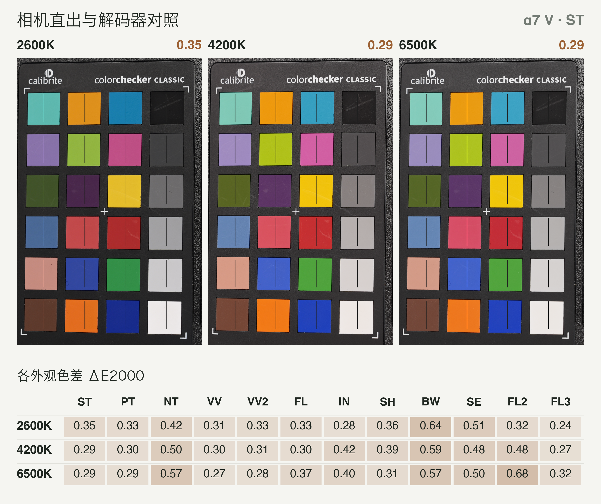
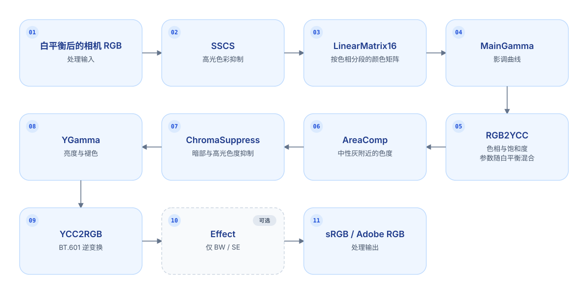

# Sony Look Bridge

[English](README.md) | 中文

本项目以 Sony Imaging Edge Edit 的显影管线为蓝本，用 Python 逐阶段复现相机的照片显影与 Creative Look，与相机直出不一致之处以相机直出为准；再将其转换为后期软件可用的配置文件和 LUT，使 RAW 在 Capture One、Camera Raw / Lightroom、DxO PhotoLab 和 DaVinci Resolve 中呈现与相机一致的颜色。

- **照片**：17 款 Sony 机型的 Creative Look 配置，每款都提供 Capture One、Camera Raw / Lightroom 与 DxO PhotoLab 三种格式。
- **视频**：α7 V 的 S-Log3 LUT，12 种外观 × 2 种输入色域 × 6 种色温版本，另附可按白平衡调节的 DaVinci Resolve DCTL。

相关介绍：[Bilibili](https://www.bilibili.com/video/BV1VUH56pECK/) · [YouTube（英文）](https://youtu.be/LeK9HhhYosQ)

上图以 α7 V 在 2600K、4200K 与 6500K 下拍摄的 ColorChecker Passport 为例（拍摄时 DRO 关闭），比较相机直出的 HEIF 与本仓库按 ARW 中的相机设置解码的结果。上方为 ST 外观，每个色块左半为相机 HEIF、右半为解码器输出，三块色卡已按白块统一显示亮度；下表为两页共 50 个色块的平均色差 ΔE2000。各配置的验证见[照片配置 § 验证](docs/photo.md#验证)。

## 下载

照片配置按机型下载，每个 ZIP 都包含三种软件的配置和安装说明。[全部机型及版本说明][release]。

| 系列 | 机型 |
| --- | --- |
| α1 / α9 | [α1][sony-a1] · [α1 II][sony-a1-ii] · [α9 III][sony-a9-iii] |
| α7 | [α7 IV][sony-a7-iv] · [α7 V][sony-a7-v] · [α7S III][sony-a7s-iii] |
| α7R / α7C | [α7R V][sony-a7r-v] · [α7R VI][sony-a7r-vi] · [α7C II][sony-a7c-ii] · [α7CR][sony-a7cr] |
| α6000 | [α6700][sony-a6700] |
| Cinema Line | [FX2][sony-fx2] · [FX3][sony-fx3] · [FX30][sony-fx30] |
| RX / ZV | [RX1R III][sony-rx1r-iii] · [ZV-E1][sony-zv-e1] · [ZV-E10 II][sony-zv-e10-ii] |

视频 LUT：**[Sony-A7-V-SLog3-Video-LUTs.zip][video-luts]**，使用方法见[视频 LUT 使用说明](profiles/video/README.md)。

α7 V、α7R VI、FX2 与 RX1R III 包含 12 种原生外观；其余机型包含 10 种原生外观，FL2 与 FL3 从 α7 V 移植。α7 V 的配置也直接保存在仓库的 `profiles/` 中。

[sony-a1]: https://github.com/751K/sony-look-bridge/releases/download/v4.0.0/Sony-A1-Creative-Looks.zip

[sony-a1-ii]: https://github.com/751K/sony-look-bridge/releases/download/v4.0.0/Sony-A1-II-Creative-Looks.zip

[sony-a9-iii]: https://github.com/751K/sony-look-bridge/releases/download/v4.0.0/Sony-A9-III-Creative-Looks.zip

[sony-a7-iv]: https://github.com/751K/sony-look-bridge/releases/download/v4.0.0/Sony-A7-IV-Creative-Looks.zip

[sony-a7-v]: https://github.com/751K/sony-look-bridge/releases/download/v4.0.0/Sony-A7-V-Creative-Looks.zip

[sony-a7r-v]: https://github.com/751K/sony-look-bridge/releases/download/v4.0.0/Sony-A7R-V-Creative-Looks.zip

[sony-a7r-vi]: https://github.com/751K/sony-look-bridge/releases/download/v4.0.0/Sony-A7R-VI-Creative-Looks.zip

[sony-a7s-iii]: https://github.com/751K/sony-look-bridge/releases/download/v4.0.0/Sony-A7S-III-Creative-Looks.zip

[sony-a7c-ii]: https://github.com/751K/sony-look-bridge/releases/download/v4.0.0/Sony-A7C-II-Creative-Looks.zip

[sony-a7cr]: https://github.com/751K/sony-look-bridge/releases/download/v4.0.0/Sony-A7CR-Creative-Looks.zip

[sony-a6700]: https://github.com/751K/sony-look-bridge/releases/download/v4.0.0/Sony-A6700-Creative-Looks.zip

[sony-fx2]: https://github.com/751K/sony-look-bridge/releases/download/v4.0.0/Sony-FX2-Creative-Looks.zip

[sony-fx3]: https://github.com/751K/sony-look-bridge/releases/download/v4.0.0/Sony-FX3-Creative-Looks.zip

[sony-fx30]: https://github.com/751K/sony-look-bridge/releases/download/v4.0.0/Sony-FX30-Creative-Looks.zip

[sony-rx1r-iii]: https://github.com/751K/sony-look-bridge/releases/download/v4.0.0/Sony-RX1R-III-Creative-Looks.zip

[sony-zv-e1]: https://github.com/751K/sony-look-bridge/releases/download/v4.0.0/Sony-ZV-E1-Creative-Looks.zip

[sony-zv-e10-ii]: https://github.com/751K/sony-look-bridge/releases/download/v4.0.0/Sony-ZV-E10-II-Creative-Looks.zip

[release]: https://github.com/751K/sony-look-bridge/releases/tag/v4.0.0

[video-luts]: https://github.com/751K/sony-look-bridge/releases/download/v4.0.0/Sony-A7-V-SLog3-Video-LUTs.zip

## 选择版本

相机会按拍摄时的白平衡改变外观的颜色：约 4100K 及以下采用暖光参数，约 5400K 及以上采用日光参数，其间逐渐过渡（以 α7 V 的白平衡设定值为例，各机型略有差异）。配置文件无法读取白平衡，因此每个彩色外观提供以下版本：

| 版本 | 名称 | 行为 | 支持的软件 |
| --- | --- | --- | --- |
| 日光版 | `Look XX` | 采用日光参数 | Capture One、Camera Raw / Lightroom、DxO PhotoLab |
| 暖光版 | `Look XX Warm` | 采用暖光参数 | Capture One、Camera Raw / Lightroom、DxO PhotoLab |
| 自动版 | `Look XX Auto` | 随白平衡变化：约 4150K 及以下与暖光版一致，约 5500K 及以上与日光版一致，其间平滑过渡 | 仅 Camera Raw / Lightroom |

- 在 Camera Raw 与 Lightroom 中建议使用自动版，调整色温时无需更换外观。
- 在 Capture One 与 DxO PhotoLab 中，约 4700K 以下拍摄的照片使用暖光版，其余使用日光版。
- BW 在任何白平衡下结果相同，只有一个版本；α7 V 的 SE 也是如此。

视频 LUT 按拍摄白平衡分为 2500K 至 7500K 的六套；DaVinci Resolve 的 DCTL 可以在六套之间连续调节。

## 安装

以下步骤以 α7 V 的文件名为例，其他机型将 `SonyA7M5` 换成对应的前缀即可。

### Capture One

1. 将 `SonyA7M5-Look-*.icc` 复制到 `~/Library/ColorSync/Profiles/`。
2. **重新启动** Capture One。Capture One 会缓存已加载的配置，不重启不会生效。
3. 在「基本特性」中将 ICC 配置文件设为 `SonyA7M5 Look XX`，并将**曲线设为 Linear Response**。

### Camera Raw / Lightroom

1. 将 `SonyA7M5 Linear Base.dcp` 与全部 `SonyA7M5 Auto Base *.dcp` 复制到 `~/Library/Application Support/Adobe/CameraRaw/CameraProfiles/`。
2. 将 `SonyA7M5 Look *.xmp` 复制到 `~/Library/Application Support/Adobe/CameraRaw/Settings/`。
3. 重新启动 Photoshop 或 Lightroom，在配置文件浏览器的 **Sony A7M5** 分组中选择外观。`Auto Base` 底座供自动版引用，无需单独选择。

部分 Photoshop / Lightroom 版本无法正确加载这些配置。例如 Lightroom Classic 15.4.1 能列出外观，但所有外观的效果都与 Linear Base 相同；Lightroom Classic 15.6 与 Camera Raw 18.7 可以正确应用。遇到这种情况时，请更新到较新的版本。

### DxO PhotoLab

1. 将 `SonyA7M5 Linear Base v2.dcp` 和 `SonyA7M5 Look *.cube` 保存到一个固定的文件夹。PhotoLab 按路径引用这些文件，移动后需要重新导入。
2. 应用 **6 – 无校正** 预设；不使用预设时，应确认 Smart Lighting、ClearView 和对比度均已关闭。镜头校正（畸变、色差、镜头锐度）可以重新开启，不影响外观颜色。
3. 在**颜色渲染**中将类型设为 **DCP 配置文件**，通过「导入 DCP 配置文件…」选择 `SonyA7M5 Linear Base v2.dcp`；将 DCP 曲线设为 **Adobe**、强度设为 100、**饱和色保护**设为 0 并关闭自动模式。
4. 在 **LUT Grading** 面板中通过「导入（.cube）…」选择 `SonyA7M5 Look XX.cube`，将 **LUT 色彩空间**设为 ProPhoto RGB、强度设为 100。
5. 可以将以上设置保存为预设，之后更换外观时只需更换 `.cube` 文件。

### DaVinci Resolve

见[视频 LUT 使用说明](profiles/video/README.md)。

## 局限

- 实拍色卡验证只覆盖 α7 V。其他机型按样张参数生成，暖光版与自动版在暖光下的准确度低于 α7 V。
- Capture One 与 DxO PhotoLab 只有日光与暖光两种状态，过渡色温下需要按画面选择。
- 荧光灯等偏绿光源下，相机会混入第三组参数，各配置均不包含这组参数。
- 配置只包含逐像素的颜色与影调；降噪、锐化和 DRO 等空间处理由各软件自己完成。

完整说明见[照片配置 § 局限](docs/photo.md#局限)。

## 原理与开发

本仓库以 Edit 的处理管线为蓝本逐阶段复现，各阶段与 Edit 的原始函数逐位比较；整体输出再以相机直出的 HEIF 与 JPEG 为参照验证。两者不一致时按相机处理：例如相机直出不做 SSCS 与 ChromaSuppress，配置与解码器默认也不包含这两步；DRO 的局部亮度，解码器默认也改用按相机 HEIF 拟合的网格，而不沿用 Edit 的网格。`sonylook/sony_decode.py` 可以按 ARW 中保存的显影设置解码出完整图像。本仓库只保留 Python 实现；带 Rust 与 Metal 加速的完整解码器在独立的 [sony-arw-decoder](https://github.com/751K/sony-arw-decoder) 仓库中维护。

| 文档 | 内容 |
| --- | --- |
| [照片配置](docs/photo.md) | 外观如何转换为三种软件的配置、各版本的原理、验证结果与局限 |
| [视频 LUT](docs/video.md) | S-Log3 到照片外观的换算、色卡标定、DCTL 与验证 |
| [处理管线](docs/pipeline.md) | Edit 各处理阶段的顺序、参数与实现 |
| [开发与发布](docs/development.md) | 生成环境与命令、重新标定、发布流程 |

| 目录 | 内容 |
| --- | --- |
| `profiles/` | α7 V 的照片配置与视频 LUT 的生成记录 |
| `sonylook/` | Edit 外观链与前端的 Python 移植、ARW 与 Edit 读取器、整图解码器 |
| `capture_one/`、`camera_raw/`、`dxo/` | 三种软件的配置生成、输入标定与测量 |
| `camera_packs/` | 机型配置包与发布附件的构建 |
| `video/` | 视频 LUT 与 DCTL 的生成、标定和测试 |
| `chart/` | 用于标定的合成色卡 ARW |
| `docs/` | 文档 |

## 说明

- 本项目与 Sony、Capture One、Adobe、DxO 均无关联，相关名称和商标归各自所有者所有。
- 配置中的 ColorMatrix 与 ForwardMatrix 取自各机型的 Adobe Standard 配置，以保持 Camera Raw 与 PhotoLab 的白平衡行为不变。
- `dxo/dxo_model.py` 按观测到的行为重新实现了 PhotoLab 的高光恢复，其中几个数值在 PhotoLab 运行时测得；仓库不包含 DxO 的代码或文件。

## 许可

- 代码、文档和生成配置的工作以 [MIT 许可证](LICENSE) 发布。
- 配置文件按原样提供。其中源自第三方的数据（Sony 的外观参数、Adobe 的色彩矩阵）不在本许可的授权范围内，本项目也不对其主张任何权利。
