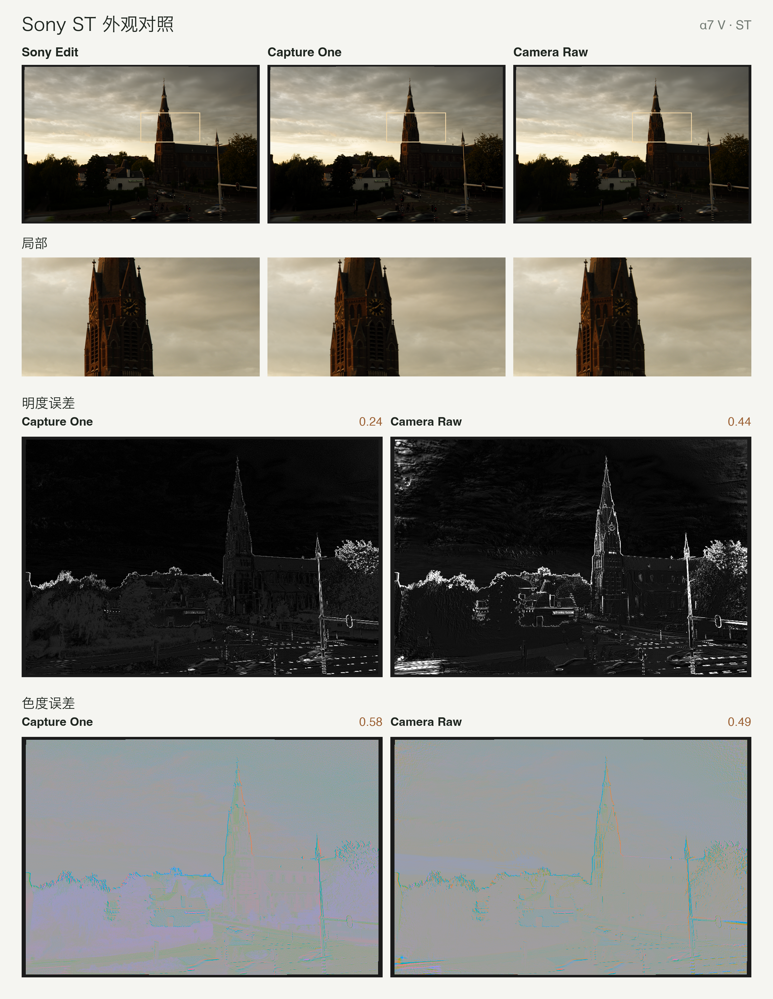

# 照片配置

本页说明 Creative Look 如何转换为 Capture One、Camera Raw / Lightroom 与 DxO PhotoLab 的配置，以及各配置的验证结果和局限。安装步骤见根目录 README，逐阶段实现见[处理管线](pipeline.md)，生成命令见[开发与发布](development.md)。

## 原理

### 外观映射

Sony Creative Look 可以视为一个逐像素映射 *f*：输入是白平衡后的相机 RGB，输出是显示用的 sRGB。宿主软件在应用配置之前，会先对相机 RGB 施加自己的输入编码 *E*，因此配置文件保存的是 `f ∘ E⁻¹`：

```text
相机 RGB ── E ──▶ 配置文件 f ∘ E⁻¹ ──▶ f(相机 RGB)
```

*f* 由外观链的逐像素阶段组成：LinearMatrix16、MainGamma、RGB2YCC、AreaComp、YGamma、YCC2RGB，以及 BW 与 SE 的 Effect。Edit 在这一段还运行 SSCS 与 ChromaSuppress，两者在亮区把颜色拉向中性；相机直出不做这两步，配置与相机一致，也不包含它们。在色卡曝光包围中，包含这两步时 +2 EV 与相机 HEIF 相差 1.93 ΔE2000，去掉后为 0.43；在 7 张实拍照片与机内嵌入 JPEG 的对照中，受这两步影响的像素有 6 张误差下降（由 2.0–4.7 降至 0.6–2.2），1 张舞台灯光照片由 0.94 升至 1.04（详见 [解码管线](pipeline.md) §10.3）。降噪、去马赛克、DRO、锐化和 Marble 等空间处理不进入配置，由宿主软件完成。配置按相机的默认外观参数生成：IN、SH、FL2、FL3 的褪色分别为 3、6、1、1，其余滑块为 0。

下图显示相机 RGB 经中性显影、ST 与 FL2 后的颜色分布：


### 宿主格式

| 宿主 | 文件 | 查找表 | 工作方式 |
| --- | --- | --- | --- |
| Capture One | ICC | 65³ A2B0 CLUT | 输入经 `c1_encoding_table.json` 记录的 *E*，输出 Lab D50；曲线必须设为 Linear Response |
| Camera Raw / Lightroom | DCP + XMP | XMP RGBTable 64³ | 线性底座 DCP 保持 Camera Raw 的白平衡行为，XMP 保存 ProPhoto γ1.8 下的外观表 |
| DxO PhotoLab Elite | DCP + `.cube` | 64³ CUBE | 底座 DCP 之后接 LUT Grading，LUT 色彩空间设为 ProPhoto RGB |

底座 DCP 使用该机型 Adobe Standard 配置的 ColorMatrix，使 Camera Raw 的白平衡行为与 Adobe Standard 一致；DxO 的底座另使用其 D65 ForwardMatrix。`dxo/dxo_model.py` 按观测到的行为重新实现了 PhotoLab 的高光恢复，其中几个常数（DxO Wide Gamut 矩阵、高光白点）在 PhotoLab 运行时测得。

### 日光版、暖光版与自动版

相机按拍摄时的白平衡，在每种外观的暖光与日光两组色彩参数之间混合。混合权重记录在 ARW 的 0x7848 中，同时作用于 RGB2YCC 参数和 LinearMatrix16 表（[处理管线 §4.1 与 §4.3](pipeline.md)）。以 α7 V 为例，白平衡设定在 4100K 及以下时完全采用暖光参数，5400K 及以上时完全采用日光参数，其间按 mired 线性混合，与白平衡的 G–M 微调无关。各机型的区间略有差异，α7 IV 约为 4100K 至 5200K。使用荧光灯暖白或冷白预设，或相机判断光源偏绿时，相机还会采用第三组（荧光灯）参数，这同样与 G–M 微调无关。

配置文件无法读取白平衡，因此每个外观生成两个固定版本：日光版采用权重 `0 1024 0 0`，暖光版采用 `1024 0 0 0`，名称以 Warm 结尾。在两种权重下结果相同的外观只生成一个版本，包括 BW 和 α7 V 的 SE。

Camera Raw 另有随白平衡变化的自动版 `Look XX Auto`。XMP 配置只能保存一张外观表，但它引用的底座 DCP 可以带两个标定光源，Camera Raw 会按当前白平衡（以 mired 计）在两个光源的 HueSatMap 之间插值。自动版利用了这一机制：

- 底座 `Auto Base XX.dcp` 的标定光源为冷白荧光灯和 D55，Camera Raw 分别按 4150K 和 5500K 处理。在 DNG 规定的标准光源中，这一组最接近相机的过渡区间：按 Camera Raw 的色温计，相机的过渡约从 4000K 到 5100K。其 ColorMatrix 由该机型 Adobe Standard 的 StdA 与 D65 矩阵按 mired 插值到这两个色温，两者之间的白平衡行为与 Adobe Standard 一致；ForwardMatrix 与线性底座相同。
- XMP 保存日光外观表。底座在 4150K 端的 HueSatMap 预先调整输入颜色，使结果等于暖光外观；5500K 端为恒等映射。
- FL2 的暖光外观能输出日光外观表无法达到的高饱和黄色，因此方向相反：XMP 保存暖光外观表，5500K 端的 HueSatMap 将结果调整为日光外观。FL2 的 HueSatMap 另含 16 级亮度轴，其余外观为 90×30 的色相、饱和度表。

HueSatMap 逐格拟合色相偏移、饱和度缩放和亮度缩放，目标为两种外观在 CIELAB 中的差异，由 `camera_raw/acr_auto.py` 生成。Capture One 与 DxO PhotoLab 没有对应机制。

### 相机与 Edit 的差异

配置以 Imaging Edge Edit 的实现为基础，但在两处按相机直出修正，因为两者在这两处不同：

- **暖光与荧光灯色彩表**：每种外观的 LinearMatrix16 有暖光、日光和荧光灯三张表，ARW 的外观 IFD 只保存日光表。α7 V 的暖光表取自 2600K 下的色卡实拍（`sonylook/warm_780f.json`），荧光灯表取自荧光灯冷白预设下的拍摄（`sonylook/fluor_780f.json`）。
- **SE**：相机的 SE 不使用 Sepia 外观的 RGB2YCC 偏移表，亮度与 BW 一致；棕色调为 (848, −1088)，而非 0x74c5 记录的值（[处理管线 §6.1](pipeline.md)）。

这两项修正目前只有 α7 V 的实测数据，其他机型仍按 Edit 生成。

### 其他机型

各机型包按同一流程生成，外观参数取自各机型的样张。α7 V、α7R VI、FX2 与 RX1R III 包含 12 种原生外观；其余具备 Creative Look 的机型包含 10 种原生外观，FL2 与 FL3 从 α7 V 移植：相机 RGB 按 Adobe Standard 的 D65 ForwardMatrix 换算到 α7 V 的相机 RGB，之后按 α7 V 的外观渲染。

α7R III 早于 Creative Look，机内只有 Creative Style。它的 12 种外观全部按上述方法从 α7 V 移植，机内的 Creative Style 参数不使用；因此其配置呈现的是 α7 V 的外观，而不是 α7R III 机内的颜色。

各机型都沿用 α7 V 的宿主输入标定。底座 DCP 使用各自的 Adobe Standard 矩阵，DxO 的高光模型使用样张的拍摄白平衡。相机的饱和度设置会缩放 ARW 中所有外观的 RGB2YCC 增益，因此样张若调过饱和度，生成时先按 MakerNote 记录的饱和度还原增益；α7 IV 的样张为 −3，α7C II 的样张为 +1，还原前两者的配置与饱和度 0 的结果平均相差 1.7–2.7 与 0.4–0.9 ΔE2000。

## 验证

### 解码器与相机直出

以 α7 V 在 2600K、4200K 与 6500K 的 COB 光源下拍摄 ColorChecker Passport（自定义白平衡，ISO 100，f/5.6，DRO 关闭），每种光源拍摄全部 12 种外观。将相机同时写入的 HEIF 与本仓库解码器的输出逐块比较，解码器采用 ARW 中记录的相机设置，包括 MakerNote 中的褪色。Passport 两页共 50 个色块的 ΔE2000 平均值如下：

| 外观 | 2600K | 4200K | 6500K |
| --- | --- | --- | --- |
| ST、PT、NT、VV、VV2、FL、FL3、IN、SH | 0.24–0.42 | 0.27–0.50 | 0.27–0.57 |
| BW | 0.64 | 0.59 | 0.57 |
| SE | 0.51 | 0.48 | 0.50 |
| FL2 | 0.32 | 0.48 | 0.68 |

Edit 打开未保存的 ARW 时，FL2 与 FL3 的褪色为 0，而相机的默认值为 1；按 Edit 的褪色解码时，两者在三种光源下的偏差分别为 0.85–1.07 与 0.68–0.80。按 Edit 的做法解码 SE 时，三种光源下的偏差为 3.1–3.4。

### 外观参数

在同一张色卡上，以 6500K 色温白平衡拍摄 ST 与 FL 的对比度、高光、阴影、饱和度各 ±9 和褪色 5、9，FL2 与 FL3 的褪色 0、1、9，以及一张组合参数，共 29 张。解码器读取 ARW 中的相机参数并给定褪色值，Classic 页 24 个色块的 ΔE2000 平均值为 0.27–0.67，与默认参数下的 0.40–0.65 相当；未经调整的渲染在这些照片上偏差最大为 8.4。

### 配置与相机直出

在同一批色卡照片上，将每种配置在同一 RAW 上的渲染与相机 HEIF 比较，取 ColorChecker Classic 页的 24 个色块。相机在三种光源下的混合权重分别为 `1024 0 0 0`、`644 380 0 0` 和 `0 1024 0 0`；自动版按 Camera Raw 由拍摄白平衡计算的色温（2825K、4561K、6503K）混合 HueSatMap。十种彩色外观的 ΔE2000 平均值如下：

| 配置 | 2600K | 4200K | 6500K |
| --- | --- | --- | --- |
| 按拍摄参数渲染 | 0.23–0.43 | 0.26–0.53 | 0.25–0.81 |
| 日光版 | 1.77–2.38 | 1.19–1.97 | 0.25–0.81 |
| 暖光版 | 0.23–0.43 | 0.83–1.20 | 1.88–2.64 |
| 自动版 | 0.27–0.75 | 0.35–0.97 | 0.25–0.84 |

4200K 下相机取 63% 的暖光权重，Camera Raw 在 4150K 至 5500K 之间按 mired 插值，同样取 63%。剩余偏差来自 HueSatMap 对两种外观之差的拟合误差。BW 与 SE 不随白平衡变化，三种光源下分别为 0.5–0.6 和 0.47–0.52。

### 宿主导出与 Edit

以 DSC03591 的 ST 外观为例，将 Capture One 与 Camera Raw 的实际导出与 Edit 导出比较。两张图在共同有效区域上计算 CIELAB D65 的亮度误差 `|L*_宿主 − L*_Edit|` 与色度误差 `√(Δa*² + Δb*²)`：



| 软件 | 平均亮度差 ΔL* | 平均色度差 Δab |
| --- | ---: | ---: |
| Capture One | 0.24 | 0.58 |
| Camera Raw | 0.44 | 0.49 |

导出哈希、几何配准和未取整的结果记录在 `images/compare_ST.measurements.json`。剩余误差主要来自宿主自身的去马赛克、锐化和高光处理。表中结果测量时，配置包含 SSCS 与 ChromaSuppress，与 Edit 相同。配置现按相机直出去掉这两步，亮区因此有意偏离 Edit：用解码器估算，DSC03591 整幅的平均色度差变化约 0.07，约 5% 最亮区域约 1.3。

FL2 与 FL3 的宿主导出早期也做过对照，8 位 RGB MAE 在 Capture One 中分别为 1.05 与 1.21，在 Camera Raw 中为 1.15 与 1.27（ST 为 1.17 与 1.27）。其余外观没有宿主导出对照。α7C II 另在 Camera Raw 中验证过 ST 与 FL2。

### 解码器与 Edit

完整解码器与 Edit 导出图的对照见[处理管线 §0](pipeline.md#0-现状)：DSC03591 的 ST 全图 8 位 MAE 为 0.125。

## 局限

- 色卡验证只覆盖 α7 V。其他机型只按样张参数生成，未经实拍验证，并沿用 α7 V 的宿主输入标定。
- 其他机型尚无暖光 LinearMatrix16 表，其暖光版与自动版只包含 RGB2YCC 部分的变化，暖光下的准确度低于 α7 V；从 α7 V 移植的 FL2 与 FL3 除外。其他机型的 SE 仍按 Edit 生成。
- Capture One 与 DxO 配置只有日光与暖光两种状态，不包含过渡色温下的混合。Camera Raw 自动版在 4150K 至 5500K 之间过渡，与相机的区间（按 Camera Raw 的色温计约 4000K 至 5100K）接近但不完全相同；此外，偏色时 Camera Raw 换算的色温与相机的色温不一致，白平衡向 G 方向微调（对应偏品红的光源）时，Camera Raw 的色温明显偏低，自动版会比相机更接近暖光状态。
- 自动版底座的 ColorMatrix 只在 4150K 至 5500K 之间与 Adobe Standard 一致。低于 4150K 时，Camera Raw 显示的色温略有不同，2600K 色卡光源下为 2825K，Adobe Standard 为 2777K；画面的白平衡不受影响。
- 各配置均不包含荧光灯参数组。使用荧光灯暖白或冷白预设，或相机判断光源偏绿时，相机采用荧光灯参数；在荧光灯冷白预设的色卡照片上，十种彩色外观的日光版与相机直出的 ΔE2000 平均值为 4.5–6.4，暖光版为 3.9–5.1，解码器按拍摄参数为 0.24–0.83。
- Camera Raw 会按画面内容自适应地压缩高光，亮区约偏亮 0.5–0.7 级，固定的 RGBTable 无法完全修正。
